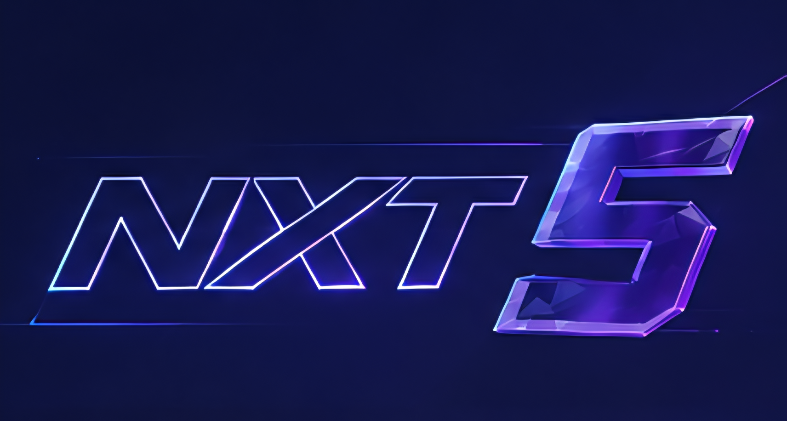

# NXT5 — Charte graphique Prisme

**Version 2.8 · 20 novembre 2026 · Source unique du site NXT5 et de son identité Importer.** Après comparaison des boutons bleus puis des dégradés, l’utilisateur choisit la proposition **2 — cyan, pervenche et lavande du NXT** et demande son application au site, à l’Importer et à cette charte. Les actions principales adoptent `linear-gradient(90deg, #67E8F9 0%, #A5B4FC 52%, #C4B5FD 100%)`, avec texte et icônes nuit `#020611`. Cette décision remplace le CTA violet à texte blanc des versions 2.1 à 2.7. Les autres rôles de boutons, les signatures officielles des fournisseurs, le logo et la composition mobile approuvée conservent leurs règles. Le choix est validé ; les contrôles et références de livraison sont documentés en section 11.

**Évolution demandée le 17 novembre 2026 — signature lumineuse.** L’utilisateur choisit l’image transmise ce jour : NXT en contour électrique cyan/lavande, 5 violet facetté et fond bleu nuit. Cette décision remplace, pour la signature, la règle 2.5 qui imposait quatre lettres pleines. Elle confirme le refus du NXT sculpté plein du 11 novembre. La grande scène d’accueil conserve le 5 historique en vraie 3D et ses animations ; son contour NXT, sa lumière et son fond s’accordent à cette nouvelle référence. Après une première capture mobile, l’utilisateur précise que **la disposition** ne lui convient pas : sur mobile, placer NXT en haut à gauche, le 5 agrandi en dessous à droite, puis l’introduction et son action sans chevauchement ; à 320 px, préserver la séparation du titre et du 5. Les logos sur pages publiques, exports et Importer suivent la nouvelle signature, avec une déclinaison couleur au contour renforcé pour les petits emplacements, selon la correction 2.7. Le verre détaillé ne se répète pas derrière les données. L’intégration de référence est conservée dans `worktrees/NXT5-neon-logo-20261117` ; son état publié est précisé ci-dessous. La référence utilisateur et les preuves de travail sont dans `2026-11-17/nxt5-neon-identity/`.

Après présentation des nouveaux rendus mobile à 390 et 320 px, l’utilisateur répond « C’est largement mieux ». Conserver cette composition lors des évolutions suivantes.

**Historique 2.7 · 17 novembre 2026 — petits logos couleur, règle de signature conservée.** Après publication de 2.6 et de l’Importer 0.4.4, l’utilisateur rejette le petit logo en haut à gauche « blanc pétant », puis confirme « Vasy » pour conserver le contour cyan/lavande et le 5 violet facetté aussi en petit. Cette correction prime sur la règle monochrome de 2.6. Elle est publiée sur le site depuis le 17 novembre à 17:00:01 (Paris), sans changement du grand hero, de sa vraie 3D ni de la disposition mobile approuvée. L’Importer 0.4.5 est publié pour Windows, Mac Intel et Mac Apple Silicon depuis le 17 novembre à 17:42:01 (Paris), après reprise du workflow officiel ; les vérifications figurent en section 11.

Direction historique de la version 2.5 : le mot **NXT5 entièrement en verre violet facetté**, incliné, avec des arêtes cyan et des reflets magenta. La référence était la proposition « Prisme » de la première exploration, sélectionnée par l’image envoyée le 10 novembre. Elle ne doit pas être confondue avec « Spectre », le rendu plus transparent de la seconde exploration. La décision du 17 novembre ci-dessus définit la signature active.

Ce document définit le système graphique Prisme et ses évolutions. La signature unifiée 2.5, son cadrage mobile et l’Importer 0.4.3 ont été publiés le 11 novembre 2026 ; les preuves et limites de ces contrôles figurent en section 11. La signature lumineuse 2.6 et sa correction 2.7 sont publiées sur le site ; leur état de livraison Importer figure en section 11. Les sections 2 à 10 décrivent les règles à appliquer, avec la décision 2.8 prioritaire pour les actions principales et les décisions 2.7 conservées pour la signature ; les descriptions des anciens masters en section 4 et les comptes rendus antérieurs de la section 11 sont conservés pour l’historique.

Aperçu historique de la direction 2.1 : `public/assets/brand/prisme/apercu-direction.png` (archive locale non publiée). Cette planche illustrait le système de 2.1 ; elle n’est ni une capture du site ni la référence de la signature 2.6.

## 1. Portée, priorité et intention

NXT5 aide les équipes et coachs de League of Legends à lire leurs parties, préparer leurs drafts et organiser leur travail. La marque doit associer **énergie collective, précision et profondeur**. Le 5 désigne les cinq rôles ; il ne devient pas une décoration répétée dans chaque composant.

La présente version remplace les prescriptions visuelles des versions 1.x : ancien logo à trident, combinaison « NXT blanc + 5 », palette de CTA arc-en-ciel, répétition des scènes et anciennes exceptions typographiques. Les décisions 2.8, puis 2.7 et 2.6, et les règles de conception des sections 2 à 10 constituent la référence graphique active ; les sous-sections explicitement historiques de la section 4 et les recettes antérieures de la section 11 documentent le passé. Le dégradé 2.8 reprend uniquement le cyan, la pervenche et la lavande du NXT ; il ne rétablit pas l’ancien dégradé cyan/bleu/fuchsia. Les contrats fonctionnels conservés dans l’annexe A restent applicables aux données, droits, états et parcours ; leurs anciennes mentions de couleur, matière, taille ou logo sont historiques. Les décisions explicites plus récentes de l’utilisateur priment toujours.

- Conserver cette seule charte Markdown dans le dépôt principal. Les autres checkouts ont un lien dans `AGENTS.md`, jamais une copie ni un PDF de la charte.
- La version publiée sur GitHub est ce même document, à `docs/charte-graphique.md`. Les chemins datés `2026-…/` et les chemins `worktrees/…` cités dans les recettes désignent des archives locales de l’espace de travail, pas des fichiers publiés dans ce dépôt. Ne pas publier la suppression de la charte canonique lors du retrait d’une ancienne copie locale.
- Lire le code du checkout concerné avant d’appliquer la direction ; les chemins et composants peuvent différer selon sa date.
- Réutiliser les composants partagés et adapter leurs tokens. Ne pas recouvrir le site d’une nouvelle couche de CSS générique à coups de `!important`.
- Une évolution graphique ne change ni les chiffres, ni les accès, ni les prix, ni le comportement des imports, ni les données saisies.
- Demande explicite du 10 novembre 2026 : appliquer aussi Prisme à NXT5 Importer, ses logos, icônes et contrôles. Conserver sa disposition et ses parcours Exporter, Collecte automatique, Historique et Paramètres. Les fournisseurs d’authentification conservent leurs signatures officielles.

**Décision du 11 novembre 2026 — sculpture animée.** L’utilisateur préfère explicitement [l’ancien 5](../public/assets/home-motion/glass-poster@2x.webp) : silhouette plus élancée, matière de verre historique, nombreux plans de facettes et biseaux. Reprendre ce volume et toutes ses animations, en accordant uniquement ses couleurs à Prisme. Cette décision remplace l’adaptation du 10 novembre qui avait élargi le 5 selon le contour du mot-symbole. Cette séparation du mot-symbole et de la sculpture a ensuite été remplacée par la décision complémentaire ci-dessous. Conserver une seule charte et vérifier le mobile, y compris le paysage.

**Décision complémentaire du 11 novembre 2026 — signature unifiée 2.5, historique.** L’utilisateur demande un 5 plus grand et moins de vide sur mobile, puis confirme « Oui, harmoniser tout le logo NXT5 ». Le 5 historique devient alors la source de géométrie commune : NXT est redessiné à sa hauteur de 4,4 unités, sa graisse de ~0,9 et son cisaillement de 0,24. Les quatre glyphes recevaient les mêmes matériaux physiques et biseaux. Le contour du 5, sa matière et ses animations restaient intacts. Cette évolution a remplacé l’obligation de conserver le dessin des lettres de l’image initiale. Le mot-symbole complet, ses versions monochromes, le signe compact, les favicons et l’Importer suivaient ce dessin unifié. La décision 2.6 du 17 novembre remplace les lettres pleines, mais conserve le 5 historique et la composition mobile en deux niveaux.

### Exploration artistique après la version 2.5 — rejetée, non publiée

Le 11 novembre, l’utilisateur demande de pousser avec Claude le NXT, la composition et la lumière, tout en conservant le 5 historique et toutes les animations, puis de montrer les rendus mobile et ordinateur avant publication. La proposition locale `codex/prisme-art-direction-preview-20261111` remplace le NXT filaire de l’accueil par des lettres rendues avec le même moteur physique que le 5, assemblées avec un espacement optique. Leur luminosité reste moindre pour conserver la hiérarchie. La scène animée du 5, sa matière et son contour restent inchangés ; le voile du sol passe derrière la sculpture, les nuages sont moins intenses et l’ambiance est légèrement assombrie. Sur mobile, le T reste entier, séparé du 5 ; le paysage rapproche les lettres et dégage les commandes.

**Décision utilisateur après présentation, le 11 novembre : « j’aime pas. Je préférais AVANT. »** Cette proposition est rejetée et ses changements locaux sont annulés. Conserver la version 2.5 publiée : NXT en contour sur l’accueil, composition et lumière antérieures à cette exploration, 5 historique agrandi sur mobile et toutes ses animations. Ne pas réintroduire les lettres pleines de cette exploration sur la seule base de la revue technique ou de l’avis de Claude.

Les preuves, limites, rendus et échanges restent archivés dans `2026-11-11/nxt5-art-direction/`, session Claude `bb137592-be34-4aa2-90ab-f9691c79408d`. Leur verdict « présentable » ne constituait pas une approbation de l’utilisateur. Aucun élément de cette exploration n’a été publié ; le kit de marque et l’Importer restent ceux de la version 2.5.

## 2. Direction artistique : le prisme au service du jeu

### Trois signatures

**La coupe.** Le logo possède une poussée vers l’avant, des diagonales franches et des terminaisons biseautées. Reprendre cette géométrie dans les illustrations et les détails d’arête, sans incliner les paragraphes, champs ou tableaux. Ne pas appliquer un `skew()` global aux composants.

**La matière.** Le 5 est en verre violet dense et facetté. Ses grandes faces restent lisibles ; les facettes intérieures sont moins contrastées que son contour. Une lumière froide arrive du haut et de la gauche, un reflet magenta discret termine le bord droit. NXT est un tracé lumineux fin, du cyan vers la lavande, sur fond nuit. Le contraste entre contour et volume est la signature 2.6. Ne pas remplacer les facettes du 5 par un verre lisse, chromé, liquide ou arrondi.

**La hiérarchie.** La marque s’exprime par une grande silhouette et des espaces réservés. Les informations s’organisent par alignement, taille et rythme. Le verre attire l’œil vers l’entrée ; il s’efface derrière les décisions et les données.

### Intensité selon le contexte

| Niveau | Contextes | Traitement |
| --- | --- | --- |
| Signature | Accueil public, première introduction, visuel de campagne | Logo Prisme en grand, fond nuit, une seule source de lumière et un espace net pour le texte. Une seule scène dominante par écran. |
| Cadre | Navigation, page d’entrée, titres et groupes fonctionnels | Surface nuit/violet, arête fine et facette périphérique contenue. Les zones de lecture restent opaques. |
| Lecture | Parties, tableaux, notes, planning, formulaires | Aplats stables, lignes et typographie. Le contexte de marque vient du cadre ; aucune réfraction derrière une valeur. |

Sur une page dense, l’identité de l’équipe ou du joueur prend la place du volume de marque. Ne pas cumuler un grand 5, un avatar et un grand pictogramme pour un même titre. Le logo du header suffit à signer une page de réglages.

### À exclure

Pas de particules, de triangles flottants, de grille cyberpunk, de halos autour de tous les panneaux, de soulignements multicolores systématiques, de verre opaque ressemblant à du plastique, de contour néon épais ou de reflets de sol dans une barre de navigation. Le tracé NXT reste fin même lorsque sa lumière est visible. Le logo sélectionné n’a pas besoin d’un trident supplémentaire. Le dégradé du logo n’autorise pas à mettre chaque titre en dégradé.

## 3. Palette et contrastes

Les valeurs suivantes sont les **tokens cibles Prisme**, pas une description de la CSS actuellement déployée. Les noms existants sont repris pour limiter les migrations inutiles. Les couleurs de matériau ne sont pas toutes des couleurs de texte.

| Rôle | Valeur | Token / usage |
| --- | --- | --- |
| Nuit de marque | `#020611` | Fond de présentation du logo et encre sombre sur accent clair. |
| Fond du site | `#070A14` | `--nxt5-bg` ; document, cadre général. |
| Surface de lecture | `#11172A` | `--nxt5-surface` ; fond opaque des données. |
| Surface élevée | `#1A2340` | `--nxt5-surface-raised` ; menus, popovers et dialogues. |
| Champ | `#0D1324` | `--nxt5-field` ; zone de saisie stable. |
| Bordure décorative | `#303B58` | Séparateurs non essentiels ; ne suffit pas à identifier un champ seul. |
| Bordure fonctionnelle | `#66779B` | `--nxt5-border-strong` ; contrôles et contours nécessaires à la lecture. |
| Texte principal | `#F4F6FF` | `--nxt5-text` ; titres, chiffres et contenu. |
| Texte secondaire | `#B8C3DC` | `--nxt5-text-secondary` ; explications. |
| Texte atténué | `#92A0BE` | `--nxt5-muted` ; métadonnées et placeholders, sans seconde réduction d’opacité. |
| Action principale | `#67E8F9 0%, #A5B4FC 52%, #C4B5FD 100%` | `--nxt5-primary-gradient` à 90° ; `--nxt5-action: #67E8F9` comme couleur de secours. |
| Action au survol | `#A5F3FC 0%, #C7D2FE 52%, #DDD6FE 100%` | Même direction ; `--nxt5-action-hover: #A5F3FC` comme couleur de secours. |
| Action pressée | `#22D3EE 0%, #818CF8 52%, #A78BFA 100%` | Même direction ; `#22D3EE` comme couleur de secours. |
| Texte sur action | `#020611` | `--nxt5-on-action` ; texte, icône et indicateur de chargement sur les trois états du primaire. |
| Lavande | `#C4B5FD` | `--nxt5-accent-2` ; texte actif, sélection et petits accents. |
| Cyan d’arête | `#67E8F9` | `--nxt5-accent` ; focus, liens et lumière de marque. |
| Magenta de reflet | `#E879F9` | Reflet propre au matériau du logo, présenté séparément des couleurs d’interface ; aucun contrôle ni texte fonctionnel en magenta. |
| Succès | `#6EE7B7` | Succès et écarts favorables avec libellé ou signe. |
| Danger | `#FDA4AF` | `--nxt5-danger` ; erreurs et actions destructives. |
| Vigilance | `#FCD34D` | Attente ou point d’attention, avec texte explicite. |
| Côté bleu | `#3B82F6`, texte `#93C5FD` | `--nxt5-side-blue`, `--nxt5-side-blue-text`. |
| Côté rouge | `#EF4444`, texte `#FF5757` | `--nxt5-side-red`, `--nxt5-side-red-text` ; rouge franc distinct du danger rose. |

### Lumière et surfaces

Le fond de cadre peut employer `linear-gradient(135deg, #191C38, #17112E 62%, #11172A)`. La facette périphérique varie entre 4 et 10 % de lavande ; elle ne traverse pas le texte. Une arête de 1 px peut aller du cyan à la lavande puis s’éteindre. La surface intérieure reste opaque. Ne pas dépendre de `backdrop-filter` pour obtenir un rendu acceptable.

Le CTA principal utilise le **dégradé NXT cyan → pervenche → lavande à texte nuit**, choisi en 2.8, y compris ses variantes de chargement et les liens présentés comme boutons. Respecter la direction de gauche à droite à 90° et l’arrêt pervenche à 52 % ; ne pas lui substituer un dégradé bleu/violet plus sombre, un aplat cyan ou l’ancien cyan/bleu/fuchsia. Texte, flèche et indicateur héritent de la même encre `#020611` ; ne pas réintroduire le texte blanc sur ces fonds clairs.

Définir les trois dégradés dans les tokens partagés du site et leurs équivalents Importer, puis les réutiliser dans chaque action principale. Conserver une couleur de fond cyan de secours. Les boutons secondaires restent en aplat nuit avec bordure et texte clair ; les actions destructives gardent leur sémantique dédiée. Une migration de primaire ne transforme pas les filtres, onglets, sélections, badges, côtés de jeu ou boutons de fournisseur en actions principales. Le dégradé 2.8 reste réservé aux CTA concernés, aux assets de marque et à quelques arêtes ; les surfaces de lecture, titres et valeurs conservent leur traitement propre.

### Sémantique et contrôle

Contrôles du dégradé 2.8 : avec le texte `#020611`, le contraste minimum sur les dégradés opaques vaut **10,16:1 au repos**, **13,58:1 au survol** et **6,79:1 à la pression**. Ces valeurs sont calculées en sRGB sur 1 001 positions par segment ; elles ne valident pas à elles seules les états composités, les transitions ou une page déployée. Contrôler les fonds réels, notamment l’atténuation d’un bouton désactivé.

Contrôles historiques effectués le 10 novembre sur les aplats de 2.1 : les trois niveaux de texte sur les quatre fonds atteignaient au moins **5,89:1** ; le blanc sur l’ancien violet primaire atteignait **5,70:1**, et **7,10:1** sur son état plus sombre ; la bordure fonctionnelle atteignait au moins **3,44:1** sur ces fonds. Les chiffres violet/blanc documentent l’ancienne palette et ne s’appliquent pas au CTA 2.8. Ces mesures ne couvraient pas les images ni les états translucides de la production.

Les côtés bleu et rouge sont indépendants du résultat. Garder le bleu à gauche et le rouge à droite dans les duels prévus ainsi, même si notre équipe joue rouge. Le vert favorable et le rose défavorable s’accompagnent de « Victoire », « Défaite », d’une icône ou d’un signe ; le sens dépend de la métrique. Une baisse des morts peut être positive. Dans le spécimen livré, le texte côté rouge `#FF5757` atteint **5,37:1** sur son fond `#EF444414` composité sur `#11172A` ; le côté bleu atteint **9,02:1**, la victoire **11,68:1**, la défaite et l’erreur **9,41:1**. Ne pas remplacer les tokens de texte par les teintes pleines des côtés.

Objectifs de conception : au moins 4,5:1 pour le texte courant, 3:1 pour les grands textes et pour les repères fonctionnels concernés. Tester les états réellement composités et la totalité de tout fond dégradé. Les ratios mesurés sur des aplats ne certifient pas une page ou une conformité générale. Aucun état important ne repose sur la seule couleur.

## 4. Système de logo et assets

### Signature active 2.7 — couleur aussi en petit

La référence de décision est l’[image fournie le 17 novembre](assets/reference-neon-20261117.png), conservée aussi avec les preuves dans `2026-11-17/nxt5-neon-identity/reference.png`. Sa composition bureau montre NXT en contour lumineux cyan/lavande, un 5 violet facetté dominant et un fond bleu nuit. Le mot NXT doit rester reconnaissable et le chiffre doit rester un **5**, jamais un S. Le grand hero conserve ses vrais mouvements 3D et ses réponses au défilement et au pointeur ; l’image jointe ne remplace pas le moteur. Sur mobile, composer NXT en haut à gauche et le 5 en dessous à droite, sans recouvrir le T, le texte ou l’action. Les rendus corrigés à 320 et 390 px ont reçu le retour utilisateur « C’est largement mieux ».

| Fichier dans `worktrees/NXT5-neon-logo-20261117/public/assets/brand/prisme/` | Usage et statut |
| --- | --- |
| `nxt5-neon-source.png` | Signature transparente 1 600 × 600 px pour les usages assez grands ; composition locale du contour NXT existant et du 5 facetté historique. Ce n’est pas un détourage pixel à pixel de l’image jointe ni un master 8K natif. |
| `nxt5-neon-{320,640,1280}.webp` | Déclinaisons web de la même composition, avec ratio conservé. |
| `nxt5-neon-interface-{320,640}.webp`, `nxt5-neon-interface-640.png` | Contour NXT cyan/lavande renforcé et 5 violet facetté : navigation, petits formats, emails, exports et Importer. Ratio 8:3 inchangé. |
| `nxt5-neon-mono-blanc.svg`, `nxt5-neon-mono-640.png` | Archives monochromes de 2.6, remplacées dans le produit après rejet du blanc plein. Ne pas les réintroduire dans les petits logos. |
| `nxt5-neon-5-source.png`, `nxt5-unified-5-*` et posters `classic-poster*.webp` | Source facettée figée de la composition 2.6, signe 5 historique et secours statiques ; la scène 3D animée garde sa géométrie et sa matière. |
| Icônes et favicons Prisme existants | Signe compact 5, maintenu pour les petites tailles ; vérifier chaque format avant toute nouvelle déclinaison. |

Le générateur local est `tools/prisme/build-neon-signature.mjs` dans ce checkout. Les consommateurs web, PNG, email, partage, publications et Importer ont été reliés aux nouveaux fichiers dans cette branche. La grande signature est servie depuis la PR 261 ; les nouveaux chemins `interface-*` correspondent à la correction 2.7, dont l’état de publication figure en section 11. Ne pas relancer l’ancien générateur `tools/logo-verre/build-brand.mjs` pour cette signature.

### Référence 2.1 — historique

Le fichier `public/assets/brand/prisme/reference-selectionnee.png` (archive locale non publiée) conserve l’image choisie le 10 novembre. Il était la référence de silhouette, de facettes et de couleur de 2.1. Il comporte un fond nuit et des marges de présentation : **ce n’est pas un master transparent prêt à placer dans un header** et il ne représente pas le choix du 17 novembre.

La signature 2.1 était composée de quatre caractères NXT5 en capitales inclinées, alignés et tous en verre violet facetté. Cette prescription de matière est historique ; la signature 2.6 garde NXT en contour. Ne pas reconstruire les lettres avec une police commerciale ressemblante.

### Déclinaisons 2.1 livrées à partir de cette référence — historique

| Variante | Usage | Règle |
| --- | --- | --- |
| Signature détaillée | Hero, présentation, partage grand format | Toute la matière et les facettes ; fond nuit compatible. |
| Signature d’interface | Header, footer, barre de navigation | Même contour et espacement ; facettes internes atténuées si nécessaire, sans frange ni reflet au sol. |
| Signe compact | Avatar de marque, sidebar réduite, chargement | Le 5 exact extrait de la signature ; pas un 5 provenant d’une autre proposition. |
| Monochrome | Petites tailles, impression une couleur, cas de contraste contraint | Silhouette fidèle en blanc ou en nuit ; pas de simulation de verre gris bruité. |
| Favicon | Onglet à 16/32 px et icône à 48 px | Silhouette simplifiée du même 5, testée pixel par pixel ; ne pas réduire aveuglément le rendu détaillé. |

Le détourage final utilise exactement la texture de la référence sélectionnée. Après les essais génératifs à franges cyan/bleues, l’utilisateur a explicitement demandé de retirer les bavures localement. Les contours sont tracés depuis les quatre silhouettes, avec une coupe intérieure de 0,8 pixel source pour écarter le fond ; l’anticrénelage du contour est rendu à la définition de sortie. Aucun changement de facettes, de couleur, d’espacement ou de police n’est introduit. Les essais génératifs restent des brouillons hors livraison.

| Fichier dans `public/assets/brand/prisme/` | Définition / emploi |
| --- | --- |
| `nxt5-prisme-8k.png` (archive locale non publiée) | **7 680 × 2 160 px**, PNG RGBA transparent, master horizontal. |
| `nxt5-prisme-source.png` | 1 536 × 432 px, version détourée à la largeur native de la référence. |
| `nxt5-prisme-{320,640,1280}.webp` | Versions web avec alpha ; choisir selon largeur affichée et densité de pixels. |
| `nxt5-prisme-5-2048.png`, `nxt5-prisme-5-256.webp` | 5 exact de la signature, dans un carré avec marge transparente. |
| `nxt5-prisme-mono-{blanc,nuit}.svg` | Silhouettes vectorielles réelles du mot complet, sans bitmap embarqué. |
| `nxt5-prisme-5-{blanc,nuit}.svg` | Silhouettes vectorielles réelles du 5 isolé. |
| `favicon.svg`, `favicon.ico`, `favicon-{16,32,48,180,192,512}.png` | 5 plein lavande sur carré nuit ; les petites tailles n’utilisent pas le verre détaillé. |
| `nxt5-prisme-planche-8k.png` (archive locale non publiée) | Planche de présentation **7 680 × 4 320 px** ; typographie et géométrie rendues à cette définition. |
| `tokens.css` | Export des tokens cibles ; sa présence ne modifie pas la cascade actuelle du site. |

**Ce que signifie 8K ici.** Le master mesure réellement 7 680 pixels de large. Sa matière est agrandie depuis l’image choisie de 1 536 × 1 024 px, dont le dessin visible occupe environ 1 336 × 307 px. L’agrandissement Lanczos ne crée pas de nouveaux détails de verre : il ne s’agit pas d’un rendu 3D ou d’une génération native 8K. Les contours alpha sont calculés à la définition finale et les monochromes restent vectoriels à toute taille. Le fichier horizontal n’est pas artificiellement étiré au ratio 16:9 ; seule la planche utilise ce ratio.

Le kit, sa présentation HTML responsive et les preuves sont conservés dans `2026-11-10/nxt5-logo-glass/` à la racine de l’espace Codex. L’archive ne contient ni copie Markdown ni PDF de cette charte. Les assets sont livrés sous des noms distincts ; les consommateurs ont été migrés dans le checkout récent `worktrees/NXT5-prisme-20261110`, branche `codex/prisme-site-importer-20261110`. Ce travail local ne certifie pas un déploiement.

### Signature unifiée 2.5 — historique publié

La géométrie de référence vit dans `src/components/brand/brand-geometry.js` du checkout concerné. Elle alimente le contour NXT du hero, le moteur de rendu et les SVG monochromes. Le fichier de référence initial conserve son statut historique ; il ne sert plus de master de production. Les noms précédents restent des alias de compatibilité, tandis que les consommateurs emploient des noms nouveaux pour éviter le cache immutable de l’ancienne signature.

- `nxt5-unified-source.png` : PNG RGBA 1 536 × 432 ; variantes WebP 320, 640 et 1 280 px.
- `nxt5-unified-8k.png` : master transparent 7 680 × 2 160, composé de quatre rendus du moteur physique à 2 187 × 1 995 chacun. Mise à l’échelle finale de 1,069 ; ne pas le qualifier de rendu natif 8K de toute la scène.
- `nxt5-unified-mono-{blanc,nuit}.svg` et `nxt5-unified-mono-640.png` : mêmes contours, usage d’interface et emails.
- `nxt5-unified-5-{256,512}.webp`, `nxt5-unified-5-2048.png` et SVG blanc/nuit : même 5 historique, sans fond.
- `unified-icon-{16,32,48,64,128,180,192,256,512,1024}.png`, maskable, ICO, ICNS et favicon SVG : contour historique simplifié en lavande sur nuit.

Le script `tools/prisme/build-unified-brand.mjs` compile les rendus contrôlés et les contours ; `build-assets.mjs` produit les formats d’icônes. Le verre ne se charge pas dans les menus : les petits logos restent monochromes. Le site conserve ses animations GSAP et le cycle de vie WebGL ; les posters historiques restent réservés au chargement, au mouvement réduit et au mode performance. Les preuves de cette évolution se trouvent dans `2026-11-11/nxt5-unified-mobile/`.

### Dimensions et protection

Mesurer `H` sur la hauteur visible des lettres, sans les marges du fichier. Conserver au moins `H/4` de vide tout autour de la signature, et `H/5` autour du signe compact. Le ratio du dessin est verrouillé ; aucune largeur ou hauteur ne se règle indépendamment. L’inclinaison appartient au dessin : ne pas lui ajouter une transformation CSS.

Pour les petites signatures, utiliser la variante couleur `nxt5-neon-interface-*` : contour NXT cyan/lavande renforcé à la génération, sans arrêt blanc dominant ni halo ajouté, et même 5 violet facetté historique. Vérifier la lecture aux tailles réelles de 80 à 200 px, sur les fonds des composants. Ne pas remplacer le 5 par un aplat blanc pour gagner du contraste. Les petits emplacements gardent leurs dimensions et leur disposition ; l’adaptation se fait dans l’asset. Les monochromes restent réservés à un usage réellement contraint à une couleur et explicitement demandé, jamais imposés par défaut au site, à l’Importer, aux emails ou aux exports. Les favicons et icônes compactes 5 déjà approuvés restent inchangés. Une déclinaison sur fond clair reste à contrôler avant usage.

Utiliser `object-fit: contain`, dimensions explicites, PNG alpha comme master raster et WebP/AVIF adaptés aux clients visés. Produire une version vectorielle réellement reconstruite pour le monochrome ; ne pas appeler « SVG » un fichier contenant seulement un PNG embarqué. Charger rapidement le logo visible à l’arrivée, sans lazy loading au-dessus de la ligne de flottaison. Alt du lien de marque : « NXT5 — Accueil » ; un doublon décoratif a un alt vide.

### Interdits et migration

Ne pas utiliser un bloc rectangulaire opaque autour du logo dans une surface différente. Ne pas appliquer de filtre de teinte, d’ombre lumineuse ajoutée ou de bordure qui altère son contour. Ne pas mélanger le 5 arrondi d’Orbite, le verre lisse de Spectre ou le NXT blanc de Monolithe avec cette signature.

L’ancien trident quitte le système cible Prisme. Pendant la migration, les anciens assets encore référencés doivent rester complets et traçables ; aucune suppression générale avant inventaire des consommateurs (header, emails, exports, Open Graph, manifest, téléchargements). Les fichiers web `nxt5-mark.png` et `nxt5-mark-160.webp` restent interdits : branche droite manquante. Le fichier homonyme de l’Importer représente un autre dessin et ne doit pas être supprimé sur cette seule base.

## 5. Typographie

**Inter locale** porte la lecture, les formulaires, les données et la navigation. **Chakra Petch 600 italique**, déjà présente dans les checkouts récents, porte les grands titres publics et les titres de chargement. Son rôle devient une ponctuation de marque, limitée aux H1 de campagne, au visuel Open Graph et au chargement. Les H2 de présentation et titres de formulaires restent en Inter ; les noms d’équipe, les notes et les tableaux restent en Inter. Le logo n’est pas une police de titrage.

Charger les WOFF2 localement avec `font-display: swap` et conserver leurs licences. Inter utilise les graisses réellement nécessaires 400/500/600/700/800 ; ne pas charger une famille supplémentaire pour les chiffres. Vérifier les accents français, anglais et espagnols. Si la police de titre n’est pas livrée dans un checkout, afficher Inter sans bloquer le contenu, puis intégrer la police et sa licence lors de la migration.

| Usage | Bureau | Mobile | Traitement |
| --- | --- | --- | --- |
| Titre public de campagne | 56–80 px | 36–44 px | Chakra Petch 600 italique, 1,04–1,12, couleur claire unie ; 2–3 lignes maximum comme objectif, jamais une coupe forcée. |
| Titre de page de travail | 32–40 px | 26–32 px | Inter 700, interligne 1,15 ; identité de l’équipe prioritaire. |
| Titre de section | 22–28 px | 20–24 px | Inter 600/700, interligne 1,25. |
| Chiffre mis en avant | 32–48 px | 28–36 px | Inter 700, chiffres tabulaires, unité à proximité. |
| Texte courant | 16 px | 16 px | Inter 400, interligne 1,55–1,7, largeur de lecture 60–68 caractères. |
| Interface et labels | 15 px | 15–16 px | Inter 500/600, casse de phrase ; champs à 16 px minimum sur mobile. |
| Métadonnées | 13–14 px | 13–14 px | Couleur secondaire lisible ; jamais une aide essentielle à 10 px. |

Les tableaux alignent les libellés à gauche et les nombres à droite. Réserver les capitales courtes aux rôles TOP/JGL/MID/ADC/SUP et identifiants utiles. Les surtitres ne sont pas obligatoires. Ne pas colorer un mot isolé de chaque titre, ni transformer tous les titres en italique. Utiliser la graisse et l’espace plutôt qu’une multiplication de styles.

### Rédaction de l’interface

Écrire d’abord l’action ou le fait utile, en une ou deux phrases courtes. Éviter de répéter le même titre, bénéfice ou parcours dans le badge, l’en-tête, la carte et les boutons d’un écran. Garder les étapes détaillées dans le guide ou un panneau ouvert à la demande. L’assistant vise 60 mots par défaut et développe seulement si la question le demande. Les définitions de métriques, montants, délais, conséquences d’une suppression et mentions légales restent exacts et accessibles ; les longs textes légaux peuvent être repliés sous des titres explicites avec une commande « Tout afficher ».

## 6. Géométrie, espacement et compositions

### Grille et proportions

Échelle d’espace : 4 / 8 / 12 / 16 / 24 / 32 / 48 / 64 / 96 px. Largeur publique cible 1 280 px ; lecture longue 68ch ; interfaces de données adaptables jusqu’à 1 600 px selon la tâche. Marges : 16 px à 320–639 px, 24 px à 640–1023 px, 32–48 px au-delà. Aucun nom ou nombre essentiel n’est caché pour tenir dans une grille.

Conserver les boutons à **2 px** de rayon, les champs à **10 px**, les panneaux à **16 px** (14 px sur mobile). Les petites surfaces internes peuvent utiliser 10 px, sans ombre supplémentaire. Un badge peut être arrondi ; un bouton ne devient pas une pilule. Les biseaux et diagonales appartiennent au décor périphérique, pas à la zone cliquable ou au contour des champs.

Padding de panneau : 24 px par défaut, 16 px sur mobile ; 20 px reste une valeur intermédiaire autorisée quand la largeur le justifie. Une section ouverte n’a pas besoin de panneau. Un seul niveau d’ombre par groupe, un seul niveau de panneau imbriqué au maximum sauf structure fonctionnelle démontrée. Éviter les collections de cartes identiques pour une simple liste.

### Pages publiques

Le logo Prisme porte la première impression. Composer une scène avec texte et CTA dans une zone réservée ; le visuel ne passe pas derrière le paragraphe. Sur bureau, le logo peut occuper une grande composition latérale. Sur mobile, raccourcir le décor pour garder le titre, le bénéfice et l’action accessibles rapidement. Les captures illustratives portent la mention « Exemple fictif » lorsque leurs données sont inventées.

Après le Hero : un exemple concret du produit, les usages Analyse/Coaching/Draft/Organisation/Discord, puis les informations utiles au démarrage. Des sections ouvertes et des changements d’échelle donnent le rythme. Ne pas répéter le logo géant dans chaque chapitre. Les pages Fonctionnalités, Démonstration et Guides réemploient cette logique à une intensité réduite. Les mentions légales privilégient la lecture.

### Cadre connecté et pages de travail

Une navigation principale, un titre clair, des actions contextualisées, puis le contenu. Conserver les largeurs de sidebar 264 px ouverte / 80 px réduite là où le shell les utilise. L’état actif associe texte lavande, fond violet discret et repère géométrique ; il ne se résume pas à un halo. La topbar est opaque et lisible.

L’accueil connecté commence par l’équipe réelle et la prochaine action. Les vues Parties, Draft, Analyses, Mon profil et Planning privilégient la donnée pertinente. Un en-tête de page dense n’a pas besoin de grand 5. Les profils et équipes conservent leurs vraies identités. Les cinq rôles sont visibles et leurs absences explicitement indiquées.

**Page Parties — imports automatiques (17 novembre 2026).** La bibliothèque des parties reste visible rapidement après l’en-tête. Le panneau d’import affiche d’abord son état en une ligne, puis au plus deux parties à finaliser avec leurs actions ; les autres parties en attente restent accessibles dans un volet nommé. Les ordinateurs liés, leur révocation, le choix du tag et l’historique des réceptions sont des détails repliables. Une liaison absente propose directement l’action de connexion ; un code généré reste visible jusqu’à fermeture. Les parties déjà importées ne remplissent plus la page de sous-cartes et se retrouvent dans la bibliothèque. Garder les compteurs, états, droits, erreurs et actions accessibles au clavier, sans débordement à 320 px. Cette réorganisation ne modifie pas le traitement des imports.

Les listes se lisent par lignes et colonnes stables ; les séparateurs et espaces remplacent les sous-cartes. Les tables larges défilent dans leur conteneur identifié, jamais à l’échelle de toute la page. Les graphiques ont unités, légende et période ; la lumière de marque ne sert pas d’axe, de courbe ou d’état.

## 7. Composants, états et iconographie

Réutiliser `src/components/ui/Core.jsx` et ses styles, puis adapter le système une seule fois. Les noms ci-dessous renvoient aux composants existants, sans affirmer que leur style est déjà migré.

| Besoin | Composant / règle cible |
| --- | --- |
| En-tête | `PageHeader` : titre, description utile, actions qui reviennent à la ligne ; surtitre facultatif et aucun décor imposé. |
| Contenu | `Surface` : `reading` opaque pour la donnée, `frame` pour un groupe structurant, `scene` uniquement pour une vraie introduction. Alias `glass` maintenu si nécessaire. |
| Action principale | `Button primary` et `LinkButton primary` : dégradé NXT 2.8, texte et icône nuit `#020611`, une action dominante par zone ; même règle dans l’Importer. |
| Action secondaire | `Button ghost` : fond nuit, bordure fonctionnelle et texte clair. |
| Destruction | `Button danger` : sémantique rose dédiée, verbe précis et confirmation adaptée au risque réel. |
| Champs | `TextInput`, `TextAreaInput`, `SelectInput` : label persistant, fond stable, aide et erreur associées. |
| États | `Badge` et `tone()` : même signification partout ; ne pas utiliser l’alias historique `orange` pour demander un vrai orange. |
| Onglets | `TabNav` : actif lisible, focus visible, libellés entiers et défilement limité à son conteneur. |
| Notifications | `ToastStack` : résultat explicite, sans masquer durablement l’action ; les erreurs restent disponibles près du champ concerné. |

États obligatoires selon le rôle : repos, survol, focus clavier, pressé, désactivé, chargement, succès et erreur. Le focus cyan mesure 2 px avec décalage de 3 px et reste visible sur les fonds concernés. Autour d’un primaire clair, préserver l’intervalle nuit entre le bouton et son anneau ; ne pas fusionner ces deux contours ni masquer le focus dans un parent rogné. Le focus ne remplace pas le dégradé de repos ou de survol.

Le primaire emploie les trois palettes définies en section 3 selon repos, survol et pression ; le survol et la pression ne s’appliquent pas à une commande désactivée. Le chargement conserve le dégradé de repos, l’encre nuit, la largeur et un libellé compréhensible ; l’indicateur utilise `currentColor`. Une action désactivée garde sa forme, son libellé et son explication, ainsi que l’attribut natif ou le contrat accessible adapté à son élément. Les primaires désactivés, y compris pendant un chargement, utilisent une opacité de 0,75 : l’ancienne valeur de 0,5 assombrissait trop leurs libellés sombres. Vérifier le contraste composité sur le fond réel ; les quatre fonds de référence du site donnent au moins 6,00:1 à 0,75. Les autres rôles conservent leur propre atténuation. Le mode de contraste forcé conserve les couleurs système plutôt que le dégradé. Les états de succès et d’erreur gardent leur sémantique et ne reposent pas sur le seul dégradé.

Ajustement de cadrage du 11 novembre 2026 : les champs simples et boutons standards partagent une hauteur minimale de **48 px**, avec un interligne de 24 px pour les champs et de 20 px pour les boutons. Les boutons à texte long grandissent avec leur contenu ; les zones de texte gardent leur hauteur liée aux lignes. Les formulaires d’entrée conservent leur exception de 52 px. Le cadre connecté utilise une même gouttière pour topbar et contenu (16 px sur mobile, 32 px sur bureau, 40 px sur grand écran) ; les séparateurs du haut de la sidebar et de la topbar se rejoignent à 76 px sur bureau. Les flèches des cartes joueur sont centrées sur la ligne icône/poste. Vérifier ces règles dans les deux ordres de chargement CSS avec les contrôles navigateur `test:framing` et `test:layout`.

Un champ mesure 48 px de haut, 52 px dans les formulaires d’entrée. Un bouton mobile vise au moins 44 px de haut ; les commandes à icône offrent une zone de 44 × 44 px. Le pictogramme peut rester à 18–20 px. Les actions ne se déplacent pas au survol. Ne pas désactiver le contour de focus sans remplacement visible.

Lucide demeure la famille d’icônes d’interface, trait cohérent et taille constante. `RoleIcon` garde les cinq rôles et leurs SVG existants ; `TeamAvatar` garde les identités fournies par les équipes. Les portraits de champions et objectifs servent la lecture du jeu. Une icône décorative n’est pas annoncée deux fois ; un bouton sans texte possède un nom accessible. Ne pas transformer les icônes utilitaires en mini-sculptures de verre.

## 8. Mobile, accessibilité et internationalisation

Concevoir à 390 px puis vérifier 320, 360, 768, 1024 et 1440 px. Les layouts partagés concernés passent aussi leurs contrôles jusqu’à 1 920 px. Tester les noms longs et FR/EN/ES ; le texte peut augmenter la hauteur des composants. Le logo ne force pas le menu hors de l’écran. Correction de cadrage du 11 novembre : sur petit écran, donner toute la largeur au nom du joueur, réserver une largeur lisible aux libellés du Wrapped, lier nombres et unités et signaler la troncature des sélecteurs par des points de suspension. Le bloc « Rester connecté » conserve 12 px de marge intérieure ; le fond statique du mode performance suit toute la hauteur du contenu.

- Le contenu garde toute sa largeur sous le seuil de sidebar. Les titres et actions se superposent avant de réduire leur police.
- Employer des requêtes de conteneur pour les listes et métriques qui doivent s’adapter à une sidebar ou à un panneau. Ne pas déduire la largeur utile du seul viewport.
- Les tableaux peuvent déborder dans leur propre zone ; aucun débordement horizontal global. Les onglets ont un défilement local et un repère de sélection visible.
- À 200 % de zoom, le contenu et les contrôles restent atteignables. À petite largeur, les actions principales et l’aide ne disparaissent pas.
- Vérifier les CTA 2.8 à 320 et 390 px, leurs libellés longs et leurs états de chargement : conserver les retours à la ligne, les hauteurs de contrôle existantes et l’espace du focus. Le dégradé couvre toute la largeur du bouton, sans largeur fixe imposée ni changement de disposition pour le faire tenir. La règle de couleur s’applique aussi aux fenêtres étroites de l’Importer, en conservant ses parcours et sa composition propre.
- Préserver l’ordre de lecture, le focus à l’ouverture/fermeture des dialogues, la navigation clavier et les noms accessibles. Vérifier la hiérarchie de titres réelle : le composant historique `PageHeader` peut émettre un `h2`.
- Les erreurs décrivent le problème et l’action possible ; elles ne reposent pas sur un contour coloré seul. Les statuts asynchrones utilisent une annonce adaptée sans répétition décorative.
- Un logo raster bien rendu à 390 px ne valide pas un favicon à 16 px. Ces contrôles sont distincts.

## 9. Mouvement, chargement et performance

**Correction explicite du 10 novembre 2026 : conserver le 5 en vraie 3D et toutes les animations antérieures, avec la matière Prisme.** La migration graphique ne doit pas simplifier le site. Restaurer la scène immersive, ses réponses au pointeur, son défilement natif animé, ses transitions, ainsi que les scènes de connexion, chargement et accueil d’équipe. Depuis le choix du 11 novembre, le verre conserve la silhouette élancée et la matière de l’ancien 5, avec uniquement un accord chromatique Prisme. Ses biseaux, facettes, réfraction et animations restent ceux du moteur historique. Les contrôles de réduction du mouvement et les protections de performance restent actifs.

Durées cibles : 120–180 ms pour un contrôle, 180–240 ms pour une transition de panneau, 400–600 ms au maximum pour une entrée de marque non bloquante. Privilégier opacité et transform ; aucun mouvement de layout qui décale une action en cours. Une séquence d’introduction ne se répète pas à chaque changement d’onglet.

`prefers-reduced-motion` et `html.nxt5-low-gpu` conservent un rendu statique complet. Ne pas ajouter de moteur 3D au header ou à un tableau. Les moteurs existants du Hero/connexion/accueil doivent conserver la sculpture historique retenue le 11 novembre, avec poster immédiat, chargement à la demande, suspension hors vue et onglet masqué, nettoyage des ressources et écouteurs. Aucune donnée utile ne dépend de WebGL.

`AppLoadingProvider` conserve un écran unique pour Ouverture / Connexion / Synchronisation. Une seule occurrence du titre de phase, une description utile et une progression réelle. Quand le total est inconnu, garder l’état indéterminé ; ne pas inventer de pourcentage ou retarder l’arrivée du contenu pour montrer le logo. Un résultat vide chargé ouvre son état vide. Les cinq rôles décoratifs ne représentent pas des connexions réelles.

Sur mobile et en faible hauteur, le signe devient compact et laisse la place au statut. Le fond, les caustiques et le reflet s’éteignent en mode performance ; l’identité et la progression restent compréhensibles. Conserver le cycle de vie et les animations existants ; cadrer les décors pour préserver les informations utiles.

Budgets cibles à mesurer à l’intégration : signature de header autour de 30–60 Ko selon variante, signe compact sous 20 Ko si possible, poster de scène sous 180 Ko à la taille effectivement affichée. Ce sont des objectifs, pas une raison de dégrader les contours ni des mesures des PNG d’exploration. Définir `width`, `height`, `sizes` et les variantes utiles, ne pas livrer systématiquement la pleine résolution.

## 10. Ton, images et supports

Français direct, tutoiement, bénéfices concrets : « Importe tes parties », « Prépare la prochaine séance », « Retrouve les notes de ton équipe ». Expliquer draft ou champion pool au premier emploi destiné à un débutant. Ne pas promettre de victoire ni inventer une adoption professionnelle, un client, une performance ou un témoignage.

Les libellés actuels **Mon équipe**, **Parties**, **Notes**, **Catégorie** conservent leur sens. Le mot débrief peut désigner une séance, mais ne remplace plus la rubrique Notes. Un état vide indique une prochaine action ; une erreur indique comment agir. Les données fictives des maquettes sont explicitement identifiées.

### Images et scènes

Les captures du vrai produit démontrent son fonctionnement, les scènes Prisme signent la marque. Ne pas présenter une maquette comme une capture de production. Les avatars et champions gardent leur ratio et leur attribution utile. Les fonds décoratifs sont réservés aux bords ou zones dédiées, sans texte fin superposé à une facette.

### Exports et réseaux

Un export de partie reste un **PNG unique**, avec noms complets, côtés, contexte, unités et données réelles ; pas de ZIP imposé. La synthèse Discord conserve sa composition courte distincte du PNG détaillé du site. Le logo ne concurrence pas le résultat ni les compositions. Les titres et statistiques ne reçoivent pas l’effet de verre.

Repères de format : Open Graph 1 200 × 630 ; paysage social 1 600 × 900 ; portrait 1 080 × 1 350 ; vertical 1 080 × 1 920 selon destination. Prévoir des marges de sécurité adaptées à l’interface de publication et vérifier les recadrages réels. La référence choisie n’autorise pas une publication automatique.

### Emails et authentification

Les emails utilisent une structure compatible, des couleurs opaques, un logo PNG testé sur son fond et une vraie version texte. Leur CTA reprend le dégradé NXT 2.8 et l’encre nuit `#020611`, avec un fond cyan `#67E8F9` de secours pour les clients sans dégradés. Il doit rester lisible en mode sombre et en cas de blocage d’image ; aucun effet CSS complexe requis. Vérifier le rendu propre aux clients email sans imposer les états interactifs du navigateur. Les durées des liens de sécurité et les destinations restent celles du produit. Les boutons Google, Discord, Apple et Riot conservent leurs assets et règles de marque propres ; ne pas leur appliquer le CTA NXT5.

## 11. Recette, livraison et état réel

### Décision 2.8 — dégradé des actions principales, 20 novembre 2026

Le 19 novembre, des prototypes locaux présentent d’abord trois boutons bleus, puis quatre dégradés. La proposition 2 reprend les trois arrêts du logo compact : cyan, pervenche et lavande. Les rendus à 1 000, 390 et 320 px, ainsi que la planche des états, sont examinés par Codex et Claude dans la session `2cf6e3ec-628e-4fa2-8163-4f43f9f68d2a`. Leurs verdicts concluent que ces quatre options sont présentables pour un choix ; ils ne constituent pas ce choix. Les lectures des quatre PNG et leurs empreintes sont consignées dans `2026-11-19/nxt5-buttons-blue/gradient-review-record.json`, avec les contrôles navigateur et de contraste. Ce compte rendu précède la décision de l’utilisateur et conserve donc son statut de proposition en attente de choix.

Le 20 novembre, l’utilisateur choisit la proposition 2 et demande son application au site, à l’Importer et à la charte. Cette décision constitue la référence active 2.8. Les contrôles des prototypes ne valent pas recette de l’application complète : documenter séparément les tests, les rendus intégrés, le déploiement web et la publication des binaires avant de les déclarer livrés. L’intégration est préparée dans `worktrees/NXT5-signature-buttons-20261120`, à partir de `ee443ef` : tokens et boutons partagés, actions de l’accueil, trois CTA email avec fond de secours, et Importer 0.4.6. La recette locale réussit : 4 574 tests web (241 fichiers), typage, traductions, build, 54 tests Importer, 18 configurations de cadrage, 20 de layout et 15 contrôles visuels du site. Les boutons sont vérifiés à 320, 390 et 1 440 px dans les deux ordres CSS ; dix scènes Importer sont contrôlées à 1 180 × 800 et 820 × 620, avec pont simulé, sans collecte réelle. Les preuves sont conservées dans `2026-11-20/nxt5-signature-buttons/`. Le statut de publication se vérifie séparément dans le déploiement Netlify du commit fusionné et la release officielle `nxt5-match-exporter-latest` ; les contrôles locaux seuls ne certifient pas ces publications. Les recettes 2.7 et antérieures ci-dessous décrivent les états historiques vérifiés à leurs dates.

### Recette historique 2.7 — petits logos couleur, 17 novembre 2026

La correction remplace les logos monochromes actifs par une variante PNG/WebP gardant le contour cyan/lavande et le 5 violet facetté. Le générateur conserve les tracés, la silhouette, la texture et le ratio ; seul le contour NXT est renforcé pour les petits formats. Les headers, la navigation, l’Importer, les emails, les exports, l’Open Graph et les publications utilisent les nouveaux chemins. Les versions des images de publication mises en cache sont incrémentées pour les futurs rendus, sans renvoyer ni effacer l’historique. L’Importer livré est 0.4.5. Les rendus aux tailles réelles de 80 à 200 px sont validés par Codex et Claude, avec lectures des huit PNG attestées dans la session `08ad45ac-7431-48b5-b5ea-62aa2b4f59d2`. Les 54 tests Importer et 92 tests ciblés locaux réussissent ; la suite complète, le layout et l’audit passent en CI sur `c0d68e6` (PR 262). La suite locale sous forte pression mémoire a été arrêtée après le succès CI, sans revendiquer de succès global local. Tous les contrôles de la PR 262 réussissent, y compris Windows et Mac. La PR est fusionnée au commit `907449a4ffd7eb1e7a2d41b1b68aa1f16c7ae9e4`. Netlify `6afc79149a08ea7523dc6c2c` est confirmé courant et ready pour nxt5.org, publié à 17:00:01 heure de Paris. La recette web de production réussit sur six vues à 320, 390 et 1 440 px, sans débordement ni erreur JavaScript ; les quatre assets servis ont les mêmes empreintes SHA-256 que les sources. La publication binaire 0.4.5 a d’abord été bloquée : les deux premières tentatives Mac du workflow `44119977512` ont été annulées après 15 minutes sans runner, faute de capacité macOS ARM64. Sur demande explicite de reprise, la troisième tentative obtient un runner et réussit ; Windows et verify-web conservent leurs succès. La publication officielle se termine le 17 novembre à 17:42:01 heure de Paris, sans changement du workflow ni du produit. Les trois téléchargements Windows, Mac Intel et Mac Apple Silicon servent bien 0.4.5 au contrôle de 17:42:46. L’archive Mac ARM64 est téléchargée une fois : son SHA-256 correspond à celui de GitHub, son package est en version 0.4.5, et le logo couleur, le HTML et le CSS embarqués correspondent exactement aux sources. Les deux autres binaires sont confirmés par leurs métadonnées et redirections, sans téléchargement local. Aucune installation ni exécution native n’est revendiquée. Le blocage initial est archivé dans `release-verification-blocked-attempt2.json`. Les preuves sont séparées dans `2026-11-17/nxt5-neon-identity/color-compact/`, notamment `production-verification.json` et `release-verification.json`.

### Publication historique 2.6 — 17 novembre 2026

Dans `worktrees/NXT5-neon-logo-20261117`, les fichiers actifs de marque, les consommateurs web, l’Importer, les exports et l’image Open Graph sont reliés à la signature lumineuse. Le hero conserve la 3D et ses animations. La disposition mobile corrigée a reçu le retour « C’est largement mieux ». La base de production `99e56b8` est intégrée avant publication ; la PR [261](https://github.com/AshaiiTV/NXT5/pull/261) est fusionnée au commit `55b004f23cc576fe4c8d36427a0489014f49d8b2`. Netlify `6afc6d739e82f043e3d6fbf6` est confirmé comme déploiement courant de nxt5.org, état ready, publié le 17 novembre à 16:10:13 heure de Paris. L’Importer 0.4.4 est publié par le workflow officiel `44110510373`, entièrement réussi, avec fin de publication à 16:19:51 heure de Paris ; les trois installateurs sont présents dans la release officielle.

La vérification complète réussit : 240 fichiers, 4 597 tests web, typage, traductions et build. Les 54 tests Importer passent. Les 20 configurations de mise en page et 18 configurations de cadrage passent sous Node 24. Le moteur 3D actif, sa pause/reprise et l’absence de débordement sont contrôlés dans Chromium à 390 et 1 440 px ; le mouvement réduit est contrôlé à 768 px. Le navigateur emploie un moteur graphique logiciel, avec le réglage produit performance=full pour les contrôles 3D. Huit scènes Importer sont vérifiées à 1 180 et 820 px avec pont preload et données simulés, sans collecte réelle. Les captures « clean » masquent seulement un message temporaire de synchronisation du consentement local ; les fonctionnalités du produit restent inchangées.

Le premier contrôle Claude dans le bac à sable avait signalé à tort une absence de connexion : l’abonnement connecté est accessible hors de ce bac à sable. La collaboration réelle reprend dans la session `08ad45ac-7431-48b5-b5ea-62aa2b4f59d2`, avec lectures des sept PNG attestées. Claude demande une correction du bouton de démo à 320 px ; la vérification du fond Importer en fenêtre défilée confirme qu’une coupure apparente provenait de la capture pleine page. Le logo monochrome de l’Open Graph suit délibérément la règle de lisibilité des petits formats. Après correction à 320 px, les contrôles FR/EN/ES et les 18 configurations de cadrage réussissent. Claude lit les sept nouveaux PNG et ne relève plus de défaut visuel matériel ; Codex confirme séparément le rendu et les interactions testées. Le verdict et les empreintes des captures sont conservés dans `accepted-sha256.json`. Le déploiement web et la publication binaire de l’Importer sont confirmés, avec builds Windows et Mac de production réussis. La tête finale de la PR est entièrement verte, y compris les builds Windows et Mac. Les détails, preuves et limites sont dans `2026-11-17/nxt5-neon-identity/RECETTE.md`. Les recettes antérieures ci-dessous restent historiques.

La recette de production vérifie les assets par SHA-256 et le rendu à 320, 390 et 1 440 px via le permalink TLS valide du déploiement courant : aucun débordement ni erreur JavaScript, vraie 3D et pause/reprise opérationnelles. Le contrôle direct de `nxt5.org` depuis ce poste est limité par le certificat d’interception du réseau local Stormshield ; aucune vérification TLS n’est désactivée. Firecrawl n’est pas connecté et l’accès web externe disponible ne parvient pas non plus à lire ce domaine. La configuration Netlify confirme néanmoins ce déploiement comme production courante du domaine. Il ne s’agit pas d’un test sur téléphone physique ni d’une exécution native de l’Importer.

Lors de la recette historique de 2.6, les trois routes de téléchargement redirigeaient vers l’Importer 0.4.4. L’archive Mac arm64 est téléchargée une seule fois et son SHA-256 correspond au digest GitHub ; la version 0.4.4 ainsi que le logo SVG néon, le HTML et la CSS contenus dans app.asar correspondent aux sources validées. Vérification effectuée à 16:22:40 heure de Paris, sans installation native. Preuves : `2026-11-17/nxt5-neon-identity/release-verification.json`.

### Contrôles de la charte 2.1

La référence exacte sélectionnée pour 2.1 est conservée dans les archives locales non publiées. Le master final est un PNG à quatre canaux, 7 680 × 2 160 px : 10 078 180 pixels entièrement transparents, 30 161 pixels d’anticrénelage et 6 480 459 pixels opaques. Les pixels transparents ont leurs composantes RGB à zéro ; aucune matte rectangulaire n’est ajoutée. Les contours ont été inspectés sur fond nuit, clair et à 100 % d’un extrait 8K. Les tailles web et les favicons ont été inspectés à leur taille d’usage.

La palette a été contrôlée par calcul sur ses aplats (ratios en section 3). La présentation HTML du kit a été vérifiée à 320, 390, 768 et 1 440 px sans débordement horizontal global. Les boutons de changement de fond, le champ d’exemple et sa réinitialisation ont été vérifiés. Il s’agit d’une présentation de marque avec données fictives ; ces vérifications ne constituent pas une recette du site en production.

La collaboration Claude utilise la session `e57f5fb7-0416-490b-b44e-0425e9bfa11b`. Après un échec initial d’authentification, la lecture de la référence choisie a effectivement réussi. La revue a entraîné la correction des petites signatures, la séparation du reflet magenta et la clarification de l’export agrandi. Claude a validé les sept rendus corrigés après lecture effective : planche, entrée mobile, composants mobile et desktop, états mobile et desktop, favicon 16 px agrandi sans lissage. Les preuves de lecture et les verdicts sont enregistrés dans le dossier de tâche. Codex a mesuré les dimensions, l’alpha et les contrastes ; Claude n’a pas certifié le master 8K ni le site en production.

### Intégration 2.2 — site et Importer

Le checkout `worktrees/NXT5-prisme-20261110`, basé sur `origin/main` du 10 novembre, intègre la signature complète dans l’accueil, les silhouettes monochromes dans la navigation, et le 5 Prisme dans les scènes de connexion, chargement et accueil d’équipe. Cette première intégration avait remplacé les scènes 3D par des images statiques ; cette simplification a été explicitement rejetée par l’utilisateur. La correction 2.3 rétablit les moteurs et animations existants avec la silhouette et la matière Prisme. `Surface` utilise une surface de lecture opaque par défaut ; les variantes de cadre et de scène restent explicites. Les CTA sont violets à texte blanc et les cartes d’effectif redeviennent opaques.

Les exports PNG, le visuel Open Graph et les emails utilisent la palette Prisme. Le favicon SVG, les PNG 16/32/180, les icônes installables 192/512 et maskable, ainsi que les conteneurs ICO Windows et ICNS macOS, sont produits par `tools/prisme/build-assets.mjs`. Les chemins actifs utilisent `public/assets/brand/prisme/`; les anciennes URLs du logo 3D restent des alias contenant le nouveau dessin pour éviter des liens cassés. Ne plus régénérer la marque avec l’ancien outil `tools/logo-verre/build-brand.mjs`.

NXT5 Importer utilise le mot monochrome, le 5 Prisme sur son encart de collecte, les mêmes tokens et les nouvelles icônes natives. Son interface reste propre à l’outil. Aucun comportement d’import, de collecte, de stockage ou de mise à jour n’est modifié. Les binaires distribués ne changent qu’après une publication distincte.

La vérification complète a réussi : 240 fichiers de tests, 4 572 tests, vérification des traductions, typage et build. Après les finitions, les tests ciblés et le build sont relancés. Les 54 tests Importer passent, de même que les 10 contrôles de mise en page de 320 à 1 920 px. Une application macOS arm64 de prévisualisation est compilée et lancée dans un profil isolé ; elle ne remplace pas une release signée et distribuée.

Les captures et rapports de recette sont conservés dans `2026-11-10/nxt5-prisme-integration/`. La revue d’intégration utilise la session Claude `73e73fb6-23b2-478f-97d6-513cc324c9f8`, avec lectures d’images attestées. Les captures finales ont reçu les verdicts visuels favorables de Codex et Claude après corrections ; les empreintes sont enregistrées dans `accepted-sha256.json`. Le code est conservé dans le commit local `d00ce11` de la branche indiquée. Les composants connectés sont examinés avec des données fictives, l’Importer avec un profil de test isolé. La recette visuelle ne couvre pas chaque état possible d’un compte réel ni l’exécution native Windows. Aucun déploiement ni envoi d’email n’est effectué dans cette intégration.

### Restauration 2.3 — 10 novembre 2026

L’utilisateur a explicitement rejeté la simplification des scènes lors de la migration : « remets le 5 en vraie 3D et toutes les animations d’avant avec la matière Prisme ». Le checkout `worktrees/NXT5-prisme-20261110` rétablit `HomeMotion`, ses transitions GSAP au défilement natif, sa réponse au pointeur et le moteur `GlassScene` dans les scènes existantes de connexion, chargement, présentation et accueil d’équipe. La silhouette est extrudée à partir du contour du 5 sélectionné ; les facettes choisies sont une texture intérieure, réfractée par une coque physique avec flancs et biseaux. Les posters de secours sont rendus depuis cette même scène, en 729, 1 458 et 2 187 px. Cette restauration ne constitue pas une génération native 8K et ne change pas les masters de marque déjà livrés.

Préserver cette richesse dans les évolutions futures. Le mode statique est réservé au chargement, au mouvement réduit, à l’absence de WebGL et au mode performance. Le 5 plus large que l’ancienne silhouette demande un cadrage adapté : marges sur tablette et grand écran, dégagement des actions en paysage, contrôle de mouvement compact de 44 px sur petit écran. L’écart de hauteur entre NXT en contour et la sculpture est voulu dans cette composition immersive ; il ne modifie pas le mot-symbole officiel.

Les preuves sont conservées dans `2026-11-10/nxt5-prisme-3d-restoration/RECETTE.md`. Session Claude `ae2361a8-4307-46a3-afc2-6a9344308175`, avec lectures d’images attestées et corrections successives jusqu’à validation des cadrages finaux. Codex contrôle séparément le pointeur, la pause/reprise, le scroll, le mouvement réduit et le mode performance. La recette porte sur Chromium et des fixtures fictives pour les états connectés, pas sur chaque téléphone physique ni chaque compte réel. La correction est publiée par la PR [253](https://github.com/AshaiiTV/NXT5/pull/253), commit `8ddada4c6b1ceb3d52778db4f4d0be7200d4a629`. Netlify `6af372e3ec9030a83251f3a6` est confirmé comme déploiement courant de nxt5.org, publié le 10 novembre à 20:42:27 heure de Paris. La CI finale réussit 4 597 tests et 20 contrôles de mise en page, le typage, les traductions, le build et l’audit des dépendances. Le moteur 3D actif et le poster Prisme sont vérifiés en production à 390 px sans débordement horizontal. L’Importer 0.4.2 n’est pas modifié par la restauration des scènes web.

### Restauration 2.4 — 11 novembre 2026

L’utilisateur a confirmé le fichier `2026-11-11/nxt5-five-comparison/ancien-5.webp` comme référence et demandé le retour de ce 5 avec sa matière historique. La sculpture reprend donc intégralement le moteur antérieur à Prisme : contour à 14 points, inclinaison géométrique de 0,24, biseaux 0,105/0,085 à six segments, facettes 11×15 et plans intérieurs, réfraction, éclairage et animation. L’accord Prisme ne touche que les couleurs de face (`#AE98EE`), de flanc (`#AC9CF0`), d’atténuation (`#7F62DA`) et de facettes (`#9C88EE`), ainsi que la couleur de fond rendue transparente. Aucun changement de rugosité, d’épaisseur, d’opacité, de dispersion ou de forme par rapport au moteur historique. Le shader intérieur retrouve l’atmosphère historique plutôt qu’une texture du 5 extrait du mot-symbole.

Les nouveaux posters `public/assets/brand/prisme/classic-poster{,@2x,@3x}.webp` sont rendus depuis ce moteur en 729, 1 458 et 2 187 px, avec alpha. De nouveaux chemins évitent de réutiliser en cache la sculpture élargie de la veille. Le cadrage paysage est réduit légèrement pour dégager la navigation et l’action principale ; les animations et tous leurs consommateurs sont conservés. Les logos, favicons et icônes du kit Prisme restent inchangés.

Recette et preuves : `2026-11-11/nxt5-five-comparison/`. Session Claude `8eece567-4e4b-41ff-a8cf-809e99172a34`. Les rendus de l’accueil à 320/390/768/1440/1920 px, en paysage 844×390 et en mouvement réduit sont examinés, avec lectures d’images attestées. Codex vérifie séparément les interactions et les tests. La PR [256](https://github.com/AshaiiTV/NXT5/pull/256) est fusionnée au commit `f0f697ffde5cfe69c90ef4c61a109d1ff5984261`. Les contrôles locaux et la CI réussissent : 4 597 tests, typage, traductions, build, 20 contrôles de mise en page et audit des dépendances. Netlify `6af46e50b60e0512ea71de73` est publié le 11 novembre à 14:35:33 heure de Paris, état ready et déploiement courant confirmé. Le moteur 3D historique, le poster classic-poster, la pause/reprise tactile et le défilement sont contrôlés sur nxt5.org à 390 px sans débordement. Les captures et limites de recette sont conservées dans le dossier indiqué.

### Publication 2.5 — 11 novembre 2026

La PR [259](https://github.com/AshaiiTV/NXT5/pull/259) est fusionnée au commit `99e56b82aa9b582f3ac9363a1428b3888404fa2d`. Netlify `6af47b8c1a5e131bc6aa880b` est confirmé comme déploiement courant de [nxt5.org](https://nxt5.org), publié à 15:32:04 heure de Paris. L’Importer **0.4.3** est publié pour Windows x64, Mac Intel et Apple Silicon ; les trois routes de téléchargement de production redirigent vers ces fichiers.

La signature complète est reconstruite autour du contour historique du 5, avec NXT de même hauteur, graisse, inclinaison et matière. Les menus, exports, emails, favicons et icônes natives utilisent les déclinaisons correspondantes. Le moteur et les animations du 5 sont conservés. Le cadrage mobile agrandit la sculpture et rapproche le texte, avec plafonnement aux largeurs intermédiaires et pause dégagée en paysage.

Les tests réussissent : 4 597 tests web, 54 tests Importer, 20 contrôles de mise en page et 18 contrôles de cadrage locaux. La CI de publication réussit aussi les compilations Windows et Mac et l’audit des dépendances. Codex et Claude ont examiné les rendus avec lectures d’images attestées ; session `1b2da33e-fb44-4e35-aa0b-2e465922cb49`. En production, Chromium à 390 et 1 440 px confirme le moteur WebGL actif et l’absence de débordement horizontal ; la pause/reprise tactile fonctionne. Le favicon, le logo monochrome et le master 7 680 px servis correspondent aux sources par SHA-256. Captures, empreintes, détails et limites : `2026-11-11/nxt5-unified-mobile/`. Il ne s’agit pas de tests sur téléphone physique, Safari ou de collecte réelle dans l’Importer.

### Publication 2.2 — 10 novembre 2026

Publication explicitement autorisée par l’utilisateur. La PR [248](https://github.com/AshaiiTV/NXT5/pull/248) est fusionnée dans `main` au commit `7092b10d520f448fab558a79d1cf0a1593657b2a`. Le site [nxt5.org](https://nxt5.org) sert Prisme depuis le déploiement Netlify `6af341d45179ea24bee02db8`, publié à 17:13:36 heure de Paris et confirmé comme production courante. Les vérifications web et responsive passent après intégration des derniers textes de main : 4 586 tests web et 10 contrôles de mise en page.

L’Importer **0.4.2 Prisme** est disponible dans la [release officielle](https://github.com/AshaiiTV/NXT5/releases/tag/nxt5-match-exporter-latest) pour Windows x64, Mac Intel et Mac Apple Silicon. Le workflow officiel réussit les tests, les trois compilations et la publication. Les liens de téléchargement du site redirigent vers les fichiers 0.4.2 correspondants. L’archive Mac arm64 téléchargée est contrôlée par SHA-256 ; ses ressources Prisme, styles et icône native correspondent aux fichiers validés. Cette vérification de paquet ne constitue pas une exécution native Windows.

L’accueil de production est inspecté à 390 et 1 440 px, ainsi que la connexion mobile : logos chargés, aucune largeur débordante ni erreur JavaScript relevée. Les favicons, icônes Apple, manifeste et signatures servis correspondent octet pour octet aux sources. Les preuves sont conservées dans `2026-11-10/nxt5-prisme-deployment/RECETTE.md`, avec captures, empreintes et identifiants de publication. Les limites de la recette connectée décrites plus haut restent applicables.

### Séquence de migration

1. Utiliser les masters livrés : alpha propre, contours fidèles, symbole isolé, monochromes et favicons. Conserver leurs noms et vérifier les fonds réels de chaque consommateur ; ne pas charger le master 8K dans le header.
2. Mettre à jour les tokens et primitives partagées dans un checkout récent, puis contrôler une page publique, une page de données, un formulaire et leurs états mobiles. Pour 2.8, inventorier les actions principales du site et de l’Importer, y compris les liens-boutons et le chargement, sans convertir les variantes secondaires, dangereuses ou officielles des fournisseurs.
3. Migrer navigation, connexion, chargement, espaces de travail et administration. Conserver leurs contrats de comportement en annexe A.
4. Décliner emails, exports, Open Graph et assets annexes après vérification de leurs contraintes propres. Inventorier puis retirer les anciens consommateurs sans casser les liens existants.
5. Lancer les vérifications exigées par le checkout, dont `npm run verify` pour le code ; `npm run test:layout` si ses instructions l’exigent. Vérifier le rendu réel, clavier, focus, mouvement réduit et mode performance.

### Critères d’acceptation

- Logo fidèle au choix joint ; aucune frange, aucun caractère ambigu ou étiré.
- Palette cible appliquée par tokens ; données et sémantiques préservées.
- Une hiérarchie visible : marque, tâche, données, actions ; pas d’empilement de décor.
- CTA principal conforme au dégradé 2.8 dans ses états de repos, survol, pression, focus, chargement et désactivation ; texte et icônes nuit lisibles, labels et erreurs accessibles.
- Zéro chevauchement ou débordement global dans les dimensions testées.
- Aucune nouvelle régression dans les données, droits, import, sauvegarde ou navigation.
- Distinguer explicitement ce qui est conçu, livré, testé localement et déployé.

## 12. Entretien, provenance et sources

Historique : la version 2.1 a remplacé la couche graphique de la version 1.69 et finalisé la livraison initiée en 2.0. La présente version 2.8 remplace la palette des actions principales par le dégradé choisi le 20 novembre et conserve les décisions de signature 2.7 ainsi que les décisions de parcours ci-dessous. Une ancienne prescription esthétique dans l’annexe n’est pas une seconde charte.

Référence active : [image du 17 novembre 2026](assets/reference-neon-20261117.png). Référence historique 2.1 : `public/assets/brand/prisme/reference-selectionnee.png` (archive locale non publiée). Exploration et preuves de 2.1 : dossier de travail `2026-11-10/nxt5-logo-glass/` à la racine de l’espace Codex, avec prompts, rendus, empreintes et échanges Claude. Le générateur utilisé pour les explorations est l’outil intégré image_gen. La finition locale autorisée conserve la texture de la référence et reconstruit les contours alpha ; les scripts et les tracés sont conservés. Inter et Chakra Petch sont fournies localement dans la présentation avec leurs licences OFL. Les propositions ne constituent pas une recherche juridique d’antériorité.

Référence active des boutons 2.8 : proposition 2 de `2026-11-19/nxt5-buttons-blue/gradients.html`, revue enregistrée dans `gradient-review-record.json` du même dossier et choisie par l’utilisateur le 20 novembre. Ces chemins désignent des preuves locales, pas une deuxième charte. Les valeurs de référence à réutiliser sont maintenues en section 3 de ce document ; conserver les règles d’états de la section 7 et vérifier les consommateurs lors de chaque évolution.

Lire en priorité, selon les fichiers présents dans le checkout :

- `src/components/brand/BrandAssets.jsx` et `brand.css` pour les consommateurs du logo et les rôles.
- `src/components/ui/Core.jsx`, `core.css`, `src/index.css` et `src/styles/surface-defaults.css` pour primitives, tokens et cascade.
- `src/components/layout/AppChrome.jsx` et `app-chrome.css` pour le shell ; ne pas reconstruire une seconde navigation.
- `src/pages/home/`, `src/components/brand/GlassScene.jsx` et les scènes publiques/auth pour l’identité et son cycle de vie.
- `src/components/loading/` pour le chargement réel et ses variantes statiques.
- `src/utils/png-report.js`, `src/components/discord/` et `shared/publications/` pour les exports ; `netlify/functions/_lib/email.ts` pour les emails.
- Les feuilles locales et tests du parcours concerné avant toute modification. Consulter le graphe local lorsqu’il existe, puis vérifier ses sources actuelles.

Les anciens checkouts peuvent encore contenir une autre palette ou version du logo : leur état ne remplace pas cette charte. Ne pas migrer un ancien checkout en écrasant les évolutions présentes ailleurs. Les instructions visuelles d’`AGENTS.md` renvoient ici ; maintenir le lien plutôt que recopier les valeurs.

## Annexe A — Contrats de parcours conservés

**Portée de cette annexe :** conserver les décisions fonctionnelles de la version précédente, avec leurs dates et détails. Les instructions de données, droits, navigation, états, textes et formats restent actives. Toute prescription graphique historique — anciens assets, tailles de titres, teintes, intensités ou libellé de variante visuelle — s’interprète désormais selon les décisions 2.8, les décisions de signature 2.7 et les règles actives des sections 2 à 10 ci-dessus. Cette annexe ne certifie pas le déploiement des fonctionnalités citées. Les décisions du 4 novembre priment sur les termes plus anciens, notamment « Débriefs » remplacé par « Notes ».

## Évolution du 4 novembre 2026 — Couleurs des côtés

Les repères de côté bleu et rouge utilisent des couleurs franches et dédiées sur tout le site, y compris les comparaisons de partie, la draft, les imports et les exports. Le rouge de côté n’emprunte plus le rose de danger ou de défaite. Dans le tableau face-à-face, conserver les cinq postes visibles, le bleu à gauche et le rouge à droite, avec les mesures détaillées accessibles dans chaque ligne. Le résultat victoire/défaite reste une information distincte.

## Évolution du 4 novembre 2026 — Notes dans l’espace équipe

L’onglet « Débriefs » de l’espace équipe devient « Notes ». Son rôle est de conserver les observations et décisions rédigées par les membres ; les statistiques, compositions, courbes, objectifs et moments de jeu restent dans « Parties ». Les notes existantes restent accessibles sans migration destructrice, y compris celles liées à plusieurs parties ou sans partie liée. Les anciens rapports purement automatiques restent stockés mais n’encombrent pas la liste Notes. La création d’un groupe ne génère plus automatiquement un débrief. La page Notes évite le bilan visuel et la file « À traiter » redondants ; le statut de traitement d’une partie reste consultable et modifiable dans Parties selon les droits existants. Les anciens liens `/rapports` continuent d’ouvrir Notes. Conserver la rédaction, le brouillon de session, la recherche et les liens vers les parties sources, avec les mêmes contrôles d’accès. Cette décision prime sur les mentions historiques de l’onglet Débriefs ci-dessous ; le mot « débrief » peut rester pour désigner une séance ou l’acte d’analyser une partie, mais plus cette rubrique de navigation.

**Précision du 19 novembre 2026.** Dans chaque fiche de partie, la première vue se nomme « Résumé ». Elle donne accès au texte intégral de chaque débrief enregistré lié à cette partie, y compris les débriefs de groupe. Elle réunit le score, les compositions, l’économie, les objectifs, les moments clés, la chronologie et la lecture par poste et par joueur. Placer « Notes » à côté de « Résumé ». Le coach et les joueurs y lisent et rédigent les notes de la partie, avec possibilité de lier d’autres parties. Une nouvelle note reste dans Notes. La bibliothèque d’équipe rassemble aussi les notes sans partie liée. Lorsqu’une observation historique est modifiée, dissociée ou supprimée dans Notes, le résumé conserve le titre, le texte intégral et les parties liées du débrief d’origine.

**Précision du 20 novembre 2026.** L’accès « Notes » se fait depuis l’onglet de la fiche de partie ou la bibliothèque d’équipe à l’adresse `/notes`. Le menu latéral, y compris sa version réduite et son tiroir mobile, ne présente plus d’entrée « Notes ».

### Clarté et prise en main — évolution du 24 septembre 2026

Demande explicite : simplifier la lecture et l’utilisation, particulièrement pour une personne qui découvre NXT5. Cette évolution conserve l’identité du 23 septembre et fait évoluer la hiérarchie, les textes et les parcours. Elle prime sur les anciennes formulations ou dispositions contraires ci-dessous. Réalisation dans `worktrees/NXT5-clarte-parcours-20260924`, base `e18f126` ; plan et compte rendu dans les documents de ce checkout.

- **Intention visible :** navigation « Équipe », « Parties », « Planning », « Mon profil », « Analyses », « Draft », « Débriefs » et « Bot Discord », avec une courte explication visible dans le menu développé et mobile. Les groupes se nomment « Au quotidien » et « Préparation et partage ». Le Guide dispose d’un accès permanent. Les identifiants et chemins techniques restent inchangés.
- **Accueil :** expliquer les bénéfices concrets avec « Comprends tes parties. Prépare la suite. », les usages en équipe et un exemple honnêtement identifié. Employer parties, joueurs et débriefs dans le parcours de découverte. « Draft » désigne le choix des champions ; « review » peut être conservé entre parenthèses pour reconnaître le terme du jeu.
- **Partie :** résultat, contexte et « L’essentiel de la partie » précèdent les analyses détaillées. Les observations automatiques gardent leurs limites et invitent à vérification. Trois sections natives repliées ouvrent statistiques/5 contre 5, points à approfondir et chronologie. Le détail se referme au changement de partie ; les exports, modifications et accès au débrief restent hors des sections repliées. Les données, notes et calculs ne sont pas transformés par les changements de vocabulaire.
- **Équipe et joueurs :** parler de titulaires, remplaçants et encadrement. Distinguer profil joueur et compte connecté ; conserver les liens directs du démarrage vers l’ajout. Proposer la suite vers l’import auprès du formulaire dès que cinq profils joueurs distincts sont disponibles. Le staff ne compte pas parmi ces cinq joueurs.
- **Import :** présenter d’abord « Choisir mon fichier » avec une explication du fichier .json. Le téléchargement de NXT5 Importer et son aide système restent dans un volet « Pas encore de fichier ? ». Après chargement, choisir le côté de notre équipe avant d’exposer les postes et les joueurs. Le nom et les catégories viennent avant la confirmation ; un texte proche du bouton explique le prérequis manquant. Réserver les actions d’import au propriétaire ou au staff de l’équipe active et conserver les validations serveur.
- Dans **Parties → Import automatique**, afficher uniquement les parties de l’équipe qui nécessitent une finalisation. Chaque ligne présente l’identifiant, la date, le motif et les actions du staff. Une partie importée ou ignorée disparaît de la liste. Quand un ordinateur est lié et que la liste est vide, afficher « Aucune partie à finaliser. » Les réglages des ordinateurs liés restent accessibles dans le volet « Liaisons de l’Importer ».
- **Lisibilité :** les labels partagés de formulaire passent à 14 px, les descriptions de page à 15 px ; texte courant 14–16 px et champs mobiles 16 px. Les petits repères du menu restent secondaires à 12 px. Utiliser l’espace et les séparateurs ; aucune réduction de police pour compenser les nouvelles explications.
- **Contrôle :** vérifier les vrais composants avec le cadre complet à 360, 390, 768, 1024 et 1440 px, les détails au clavier et les états avec/sans équipe, données ou droit d’import. La vérification synthétique n’est pas un test utilisateur réel et ne prouve aucun gain chiffré de compréhension.

### Clarté des autres pages — extension du 24 septembre 2026

Demande explicite : reprendre les autres pages avec le même ton, après validation de la première passe. Réalisation dans `worktrees/NXT5-clarte-pages-restantes-20260924` ; inventaire et contrôles dans `docs/clarte-pages-restantes-2026-09-24.md` de ce checkout. Cette extension complète les règles précédentes, sans modifier les calculs, les autorisations, les prix ni les contenus saisis par les utilisateurs.

- **Planning :** distinguer « Mes disponibilités » et « Ajouter une séance ». Placer l’état d’enregistrement automatique avant la grille. Regrouper remplissage multiple et légende dans des détails natifs, avec explication du remplacement des disponibilités. Afficher Entraînement, Match et Débrief tout en préservant les identifiants et valeurs enregistrées.
- **Draft :** « Champions des joueurs » explique le champion pool ; l’ajout conduit directement à la recherche du catalogue. Définir Confiance, Situationnel, En validation et En entraînement. Dans Compositions, proposer le choix direct d’un champion pour chaque rôle, avec portraits et analyses secondaires à ouvrir au besoin. Garder Modifier et Dupliquer explicites.
- **Profil :** Synthèse, Champions, Champions déclarés, Historique et Suivi. Séparer résultats observés dans les parties et maîtrise déclarée par l’équipe. La piste à vérifier et l’action suivante précèdent les chiffres. Expliquer participation aux éliminations (KP) et sbires/monstres (CS), sans transformer une estimation en certitude.
- **Analyses :** Synthèse, Évolution, Comparer, Champions et Objectifs. Présenter une piste de débrief en premier ; plan de jeu, contributions des rôles, compositions et vigilances supplémentaires restent accessibles dans des détails natifs. Distinguer quantité de CS et écart de CS face à l’adversaire dans les objectifs. Les sources, périodes, seuils et exports conservent leurs valeurs.
- **Compte et Discord :** identité en premier dans Paramètres, mot de passe et affichage repliables, abonnement ensuite. Ne pas démonter les formulaires lors du repli : conserver saisies, erreurs et protections. Décrire la connexion Discord et ses prérequis en étapes concrètes, en reprenant les commandes effectivement disponibles.
- **Administration et pages publiques :** employer « Comptes et abonnements » pour les comptes connectés, réserver profil aux joueurs et à l’encadrement. Donner une intention concrète aux écrans d’administration, d’exports et de contact. Les pages de vente gardent les tarifs, conditions et restrictions existants.
- **Aide :** synchroniser les réponses et suggestions de l’assistant avec les libellés et parcours visibles. Conserver les anciens termes dans les mots-clés pour que les recherches avec game, review ou champion pool restent utiles.

### Corrections de l’audit — évolution du 28 septembre 2026

Demande explicite : appliquer les recommandations de l’audit ergonomie, direction artistique, sécurité et pertinence. Réalisation dans `worktrees/NXT5-audit-20260928`, branche `codex/audit-corrections-20260928`, à partir de `d31a75f`. Cette évolution complète les règles précédentes et prime sur le prérequis historique de création manuelle des cinq profils avant le chargement d’un fichier.

- **Découverte :** l’accueil montre le bilan d’une vraie vue du produit avec des données fictives clairement signalées. `/demo` permet de filtrer trois parties, de comparer leurs indicateurs et de lire un exemple de débrief sans compte. Ne jamais présenter ces données comme les performances d’un client réel. Réutiliser les composants et les calculs existants ; distinguer les faits, les questions à vérifier et les actions proposées.
- **Pages publiques :** Fonctionnalités alterne l’exemple de partie et des chapitres courts dont les précisions sont repliables. Les guides publics « Importer mon premier scrim » et « Préparer un débrief utile » prolongent le parcours. La gratuité actuelle et le besoin de Windows ou Mac avec League of Legends pour l’import sont visibles avant l’inscription. Les labels de connexion restent à 14 px, les champs mobiles à 16 px.
- **Premier import :** permettre au propriétaire ou au staff de charger le JSON avant de disposer des cinq profils. Après choix du côté, proposer les noms et Riot IDs des profils manquants, modifiables et créés uniquement sur action explicite. Expliquer que cette création subsiste si l’import est ensuite annulé ; conserver l’association aux profils existants, la validation serveur et la confirmation finale séparée.
- **Débriefs :** garder le brouillon par compte et équipe en mémoire de session lors d’une fermeture ou d’un changement de rubrique. « Fermer et garder le brouillon » et « Reprendre le brouillon » rendent le comportement explicite. Confirmer le remplacement ou la suppression, prévenir avant rechargement/déconnexion, désactiver fermeture et saisie pendant la sauvegarde. Ce stockage ne survit pas au rechargement ; ne pas promettre une récupération persistante.
- **Dialogues et navigation :** utiliser le dialogue natif partagé pour isoler le fond, contenir le focus et le rendre au déclencheur. Retour ferme une opération ; confirmer seulement l’abandon d’un import ou d’une édition modifiés. Les onglets utilisent flèches, Début et Fin et désignent leur panneau ; la navigation administrative entre pages reste constituée de liens. Un changement de rubrique replace le focus dans le contenu principal.
- **Planning :** jusqu’à 640 px, afficher une journée sélectionnable avec des créneaux confortables ; conserver la semaine au-delà. Une seule entrée clavier par grille, déplacement aux flèches, Début/Fin et accès aux séances par Maj+F10. Réutiliser les rôles, couleurs de disponibilité et traitements des séances existants.
- **Invitations :** présenter un lien temporaire à copier, l’expiration et la révocation. Expliquer que créer un lien révoque les précédents ; permettre une révocation explicite. Les jetons longs peuvent revenir à la ligne et ne doivent pas élargir la page.

### Mon équipe — libellé et adresse du 12 octobre 2026

Demande explicite : renommer l’entrée principale « Équipe » en **« Mon équipe »**, avec l’adresse canonique **`/mon-equipe`**. Ce libellé s’applique au menu sur ordinateur et mobile, au titre de navigation et aux raccourcis qui désignent cette page. Les nouveaux liens internes et invitations utilisent cette adresse. Conserver une redirection depuis `/equipes` et `/equipes/`, avec leurs paramètres et leur ancre, pour les favoris et invitations existants. Cette décision remplace la conservation historique de ce chemin technique ; l’identifiant `teams` et la rubrique administrative `/admin/equipes` restent inchangés. Les équipes adverses restent dans Parties > Équipes.

### Analyse des drafts et des bans — évolution du 12 octobre 2026

Demande explicite : faire de l’onglet « Drafts & bans » un outil de préparation utile. Réalisation dans `worktrees/NXT5-draft-ban-intelligence-20261012`, sur la base `a259571`. L’identité graphique reste inchangée ; cette section précise la hiérarchie et le sens des données.

Extension explicite du même jour : l’ouverture d’une draft doit présenter un véritable tableau visuel de sélection, avec les deux équipes, leurs picks et leurs bans, puis permettre de parcourir les choix pas à pas. Cette évolution conserve les portraits, les couleurs de côté et les composants NXT5.

- **Perspective :** ouvrir sur « Bans contre nous », avec « Nos bans » comme autre choix. Nommer le camp qui effectue le ban et celui dont on examine les options ; un ban retire le champion aux deux équipes.
- **Lecture :** périmètre (adversaire, côté, rattachement, patch et format), synthèse des retraits, exposition des pools actuels, classement interactif des champions, fiche d’interprétation, puis rotations de nos picks. La chronologie complète et les anciennes fréquences restent accessibles dans des volets repliables.
- **Bans :** afficher nombre et dénominateur, phase 1 avant les picks, phase 2 après trois picks de chaque camp. Les bandes cyan/violet montrent la répartition entre phases exploitables, jamais une puissance ou une probabilité conditionnelle. Conserver leur légende et les données inconnues distinctes des bans volontairement passés.
- **Joueurs :** rapprocher les champions bannis des pools déclarés actuels et des rôles réellement observés, en précisant les sources. Compter une seule fois chaque draft par joueur et rôle dans l’exposition du pool. Ne pas prétendre connaître les pools historiques ou l’intention adverse. Les alternatives sont les champions réellement joués au même rôle dans des parties liées compatibles, pas des recommandations de puissance.
- **Rotations et preuves :** regrouper les picks consécutifs selon le premier camp réel, y compris une ouverture rouge. Aucun rôle n’est déduit du rang du pick ; aucun ordre n’est inventé sans preuve enregistrée. Chaque détail permet d’ouvrir sa draft source avec focus visible et contexte des picks déjà révélés.
- **Tableau de draft :** présenter les deux camps nommés, bleu à gauche et rouge à droite sur grand écran, avec « Notre équipe » et « Adversaire » en complément. Les cinq picks dominent chaque camp ; les cinq bans sont regroupés dans une zone distincte plus compacte. Conserver les noms de champions comme texte lisible indépendamment des images et les rangs de sélection, sans les transformer en rôles joués. Les phases et l’action sélectionnée restent identifiables par du texte, pas seulement par une couleur. Réserver les cadres aux emplacements des champions, sans empiler vingt cartes descriptives.
- **Lecture pas à pas :** ouvrir sur la composition finale ; les commandes permettent ensuite de revoir les choix depuis le début, de parcourir les étapes et de retrouver le résultat complet. Les choix futurs restent masqués dans l’état intermédiaire ; un emplacement à venir, une donnée inconnue et un ban volontairement passé ont des libellés distincts. Réutiliser uniquement l’ordre vérifié et reconstitué depuis la source, y compris lorsque le rouge ouvre. Sans cet ordre, garder le tableau final consultable et expliquer l’indisponibilité de la progression. Ne pas ajouter de minuteur, de journal des clics, d’autoplay ou d’animation qui ferait croire à un enregistrement réel de la draft.
- **Présentation :** réutiliser Surface, les contrôles partagés, portraits et tokens. Classement et fiche côte à côte lorsque la largeur du conteneur suffit, empilés sur mobile ; texte courant au moins 14 px, contrôles au moins 44 px. La sélection mobile conduit à la fiche sans cacher son titre sous le bandeau fixe. Vérifier 360, 390, 768, 1024 et 1440 px avec le vrai cadre connecté.
- **Tableau sur mobile et clavier :** recomposer les camps et leurs emplacements sans débordement horizontal global ; conserver les noms des deux équipes, les cinq picks et les bans consultables. Les boutons de progression gardent leurs noms accessibles, leur état désactivé aux limites, leur focus visible et leurs cibles de 44 px. Le changement de draft réinitialise la lecture à un état cohérent ; les liens vers Drafter et la partie associée restent disponibles.

`src/components/draft/DraftBoard.jsx` et `draft-board.css` portent ce tableau partagé. `shared/draft-order.js` reste la source de l’ordre vérifié ; le tableau ne reconstruit pas une séquence à partir des rôles finaux.

### Équipes adverses — clarification du 12 octobre 2026

Demande explicite : rendre compréhensible la page des équipes adverses. Réalisation dans `worktrees/NXT5-draft-ban-intelligence-20261012`. Le parcours de **Parties > Équipes** devient un annuaire, puis une fiche qui utilise toute la largeur disponible. Il remplace l’ancienne disposition annuaire étroit et longue fiche côte à côte, sans changer l’identité NXT5 ni les règles de rattachement.

- **Annuaire :** présenter les équipes par leur nom, le nombre de parties rattachées, le nombre de drafts liées et la dernière partie référencée lorsqu’une date est disponible. Une recherche par nom, un tri explicite et le nombre de résultats permettent de retrouver une équipe. Conserver les contrôles lorsque la recherche est vide. L’ajout d’une fiche s’ouvre à la demande, avec nom, notes facultatives et validations existantes ; il reste réservé aux droits autorisés.
- **Navigation :** l’ouverture d’une équipe remplace l’annuaire par sa fiche. « Toutes les équipes » restitue la recherche et le tri, puis le focus à l’équipe ouverte lorsqu’elle est encore affichée. À l’ouverture, le titre de la fiche reçoit le focus sans passer sous le bandeau fixe. Conserver les accès directs par identifiant et les états chargement, erreur, fiche vide et lecture seule.
- **Compteur de navigation :** l’onglet « Équipes » affiche le nombre total de fiches adversaires de l’équipe active, y compris celles sans partie, dans le même badge que « Parties » et « Groupes ». Ce total reste indépendant de la recherche et suit les créations et actualisations de l’annuaire. Avant chargement ou en l’absence de valeur fiable, afficher « — » ; réserver « 0 » à un annuaire effectivement vide.
- **Actualisation automatique :** l’annuaire et la fiche se mettent à jour après un ajout, une modification, un retrait ou un changement de rattachement de partie ou de draft. Vérifier aussi les données au retour dans l’onglet ou la fenêtre, puis toutes les 30 secondes tant que la page est visible. Ces actualisations conservent le contenu affiché, la recherche, le tri, les filtres, la fiche et la rubrique ouvertes, les saisies en cours et le focus ; elles ne remplacent pas la vue par un écran de chargement. Retirer « Actualiser » des deux vues. Conserver « Réessayer » uniquement en cas d’erreur, sans effacer les données déjà disponibles.
- **Synthèse :** afficher le nom de l’adversaire puis trois indicateurs : **Parties rattachées**, **Notre bilan contre eux**, **Drafts liées**. Le bilan écrit victoires et défaites de notre équipe, distingue les résultats inconnus et n’assimile pas leur absence à une défaite. Les notes du staff restent dans un volet natif replié, avec leurs retours à la ligne et leur contenu saisi intacts.
- **Trois rubriques :** **Vue d’ensemble**, **Parties**, **Drafts** organisent une seule zone de contenu. Réutiliser les onglets partagés avec leurs noms, panneaux associés, sélection annoncée, focus visible et commandes clavier. Changer d’adversaire revient à sa vue d’ensemble.
- **Vue d’ensemble :** les classements « Leurs champions joués » et « Leurs bans contre nous » précèdent un aperçu de trois parties. Montrer cinq champions au départ et donner accès au classement complet. Chaque fréquence garde son dénominateur et sa couverture. Les picks de draft non confirmés dans les participants restent dans une section secondaire distincte. Expliquer la méthode à la demande ; ne pas transformer une fréquence en prédiction de la prochaine draft.
- **Parties :** présenter des lignes compactes avec résultat de notre équipe écrit et coloré, identité, date de référence et accès à la partie. La composition adverse s’ouvre au besoin. Conserver le filtre de résultat, le compteur et le chargement progressif de la liste, avec un état sans résultat distinct d’une fiche vide. Les groupes rattachés restent accessibles dans un volet secondaire.
- **Drafts :** ne retenir que les drafts valides actuellement rattachées aux parties de cette équipe. Le nom fourni par Drafter ne crée aucune association. La liste compacte permet d’ouvrir le tableau visuel partagé ; « Retour aux drafts » restitue la liste et son focus. Conserver l’accès à la source Drafter, à la partie et aux états sans draft. Une partie dédupliquée ne produit pas plusieurs observations dans les compteurs.
- **Dates et données :** conserver « Dernière partie référencée » tant que la source peut fournir une date d’import en l’absence de date de jeu. L’aide explique cette limite ; ne pas renommer ce repère en date de jeu certaine. Une donnée absente reste indisponible. Les notes humaines, les parties jouées et les choix observés uniquement dans une draft restent distincts.
- **Présentation et contrôle :** réutiliser `Surface`, `Button`, `TabNav`, les champs, portraits et couleurs sémantiques existants. Les cartes servent à choisir une équipe dans l’annuaire ; la fiche utilise des zones ouvertes et des séparateurs. Conserver le texte courant à 14 px minimum, les champs mobiles à 16 px, les cibles de 44 px et les noms entiers. Vérifier le parcours annuaire → fiche → draft → retour, le clavier et l’absence de débordement à 360, 390, 768, 1024 et 1440 px dans le vrai cadre connecté.

`src/components/opponents/OpponentsWorkspace.jsx` et `opponents-directory.css` définissent cette lecture en réutilisant les éléments partagés de `opponents-workspace.css`. `src/utils/opponent-observations.js` conserve la distinction entre participants joués et draft liée, la déduplication et la couverture des données.

### Accueil public

Depuis le 12 octobre 2026, `HomeMotion.jsx` et `home-motion.css` portent l’accueil public immersif : sculpture 5 en verre violet, lettres NXT en contour selon la composition validée, atmosphère de nuages et présentation du produit au défilement natif. Le wordmark officiel conserve sa forme dans la navigation. « Créer mon espace », la démonstration et la connexion restent directement accessibles ; le lien pour passer l’introduction et le contrôle de mouvement font partie du parcours. Le poster et la composition statique restent complets sans WebGL ou en mouvement réduit.

`ProductStory.jsx` présente les trois aperçus interactifs Analyse, Draft et Planning, avec données fictives explicitement identifiées. L’instant sélectionné doit rester cohérent entre courbe, repères, valeurs et notes. Aucun chiffre de performance inventé, faux client ou exemple présenté comme une donnée réelle. Cette composition remplace l’ancien accueil à simple aperçu Games ; les textes, contrôles et navigation FR/EN/ES restent accessibles sur mobile.

### Cadre connecté

Le cadre utilise `AppChrome.jsx` et `app-chrome.css`. À partir de 1024 px, la sidebar mesure 264 px ouverte et 80 px réduite ; l’espace principal et les overlays suivent cette largeur. Sur mobile, le menu devient un tiroir avec fond masquant, gestion du focus et fermeture au clavier. Les contrôles restent accessibles ; l’élément actif se distingue par un fond violet plus profond, un reflet diagonal et un filet multicolore de 2 px. La sidebar évoque une tranche de verre ; les autres entrées restent calmes. Le wordmark et le favicon complet servent respectivement aux variantes ouverte et réduite.

La barre supérieure est compacte, avec rubrique courante et sélecteur d’équipe. Les actions secondaires restent sobres ; l’assistant devient un accès discret. Le guide de démarrage utilise des étapes ouvertes et se masque selon la préférence existante. L’accueil Équipes conserve le roster direct décrit ci-dessous, sans réintroduire le bloc « Décisions staff ».

### Pages de travail plus compactes

Évolution autorisée le 15 septembre 2026 : réduire le défilement dans la majorité des pages de travail. Les informations utiles doivent commencer plus haut et plusieurs blocs doivent partager une rangée lorsque leur contenu reste lisible. Cette règle remplace les anciens repères de hauteur des titres denses et l’empilement systématique des grilles concernées.

- **En-têtes :** conserver `PageHeader`, son surtitre, sa description et ses actions. L’amplification du 13 octobre unifie le titre entre 32 et 50 px, avec 28 à 36 px sur mobile, et ouvre le bandeau sur l’horizon ; rapprocher les actions de l’en-tête lorsqu’elles tiennent et éviter de recopier une échelle particulière pour le mode dense. Les textes reviennent à la ligne et gardent leur contenu entier.
- **Espaces :** privilégier 12 px entre petits groupes et 16 px entre zones principales. Dans le cadre partagé refondu, le contenu reçoit 32 px de padding sur bureau, 20 px verticalement et 16 px latéralement sous 768 px ; au-delà de 1600 px, les marges passent à 36 px verticalement et 40 px latéralement. Les anciens réglages de compacité ne doivent pas écraser ces valeurs à travers des sélecteurs globaux. Conserver les espacements utiles aux libellés, aux listes et aux interactions ; la compacité vient surtout des grands espaces verticaux retirés.
- **Colonnes :** utiliser la largeur réelle du conteneur, en tenant compte de la sidebar. Les grilles propres à chaque page placent côte à côte les contenus qui restent lisibles et s’empilent lorsque la place manque. `nxt5-metric-grid`, `nxt5-kpi-grid` et `nxt5-workspace-kpis` utilisent `auto-fit` avec un minimum de 9 rem, plafonné à 100 % du conteneur : deux métriques peuvent rester côte à côte sur mobile lorsqu’elles tiennent. Ne pas appliquer ce gabarit aux tableaux, aux compositions de champions ni aux autres grilles dont le nombre de colonnes porte un sens.
- **Équipe, Planning et Compte :** rapprocher les synthèses de leurs contenus et disposer les blocs complémentaires côte à côte lorsque la largeur suffit. Les sections, les fonctions d’édition et les états existants restent accessibles ; conserver l’ordre de lecture lorsque les blocs s’empilent.
- **Lisibilité :** conserver les tailles de texte courant, les labels, les unités, les aides et les états. Ne pas réduire les textes de lecture, tronquer une information essentielle ou masquer un contrôle pour faire tenir davantage de contenu. Les contrôles mobiles gardent au moins 44 px de hauteur, les champs 16 px de texte et les cellules de calendrier 56 px de hauteur minimale.
- **Périmètre et validation :** cette évolution concerne les pages de travail du site. Les compositions de présentation publique et l’application `importer-app` conservent leurs règles. Vérifier au minimum 360, 390, 768, 1024 et 1440 px, sidebar comprise, ainsi que le retour à la ligne, l’ordre de lecture, le clavier et l’absence de débordement horizontal global.

Les composants partagés, `core.css`, `app-chrome.css` et le cadre de `src/AppContent.jsx` portent cette hiérarchie. Les règles de compatibilité des anciennes grilles dans `src/index.css` subsistent ; elles ne doivent pas repeindre les états, écraser les espacements ou annuler systématiquement les troncatures. Les adaptations de `Teams.jsx`, `Planning.jsx`, `AccountSettings.jsx` et leurs feuilles locales complètent la mise en page selon leur contenu ; `src/pages/admin/administration.css` rapproche le contenu de son cadre administratif.

### Zone de téléchargement de NXT5 Importer

Évolution autorisée le 8 septembre 2026 : simplifier la zone de téléchargement du **site web**, désormais ouverte à la demande dans Games, en conservant la palette et les composants existants.

- Présenter le téléchargement dans une seule `Surface`, sans cartes internes ni répétition du parcours d’import.
- Proposer un menu déroulant natif avec le libellé persistant « Version de l’application » et trois choix : Windows (64 bits), Mac Apple Silicon et Mac Intel. Un unique lien bouton « Télécharger » utilise l’URL correspondant au choix sélectionné. Conserver les URL et architectures existantes ainsi que l’accès au clavier.
- Séparer la ligne « Déjà un fichier JSON ? » des téléchargements par un trait léger. Utiliser un véritable `Button` accessible au clavier pour ouvrir le sélecteur de fichier, avec focus visible et états de chargement et désactivation.
- Afficher l’assignation de la game uniquement après le chargement d’un JSON. Conserver la progression d’envoi, les validations, le changement de fichier et la réinitialisation.
- Sur petit écran, empiler le menu de version et le bouton de téléchargement ; conserver les libellés entiers et les actions JSON distinctes, sans défilement horizontal global.

Cette règle concerne la zone de téléchargement du site ; elle ne modifie pas la mise en page de l’application `importer-app`.

### Aide à la première ouverture de NXT5 Importer

Évolution autorisée le 23 septembre 2026 : le clic sur « Télécharger » ouvre l’aide « Ouvrir NXT5 Importer » et lance immédiatement le téléchargement. La fermeture de l’aide ne conditionne jamais la récupération du fichier.

- Choisir le panneau initial à partir de la version téléchargée : Windows pour le fichier Windows, macOS pour Mac Intel et Apple Silicon. Deux onglets Windows / macOS permettent de consulter l’autre procédure sans changer le fichier sélectionné ni relancer le téléchargement.
- Garder un accès permanent « Aide à l’ouverture » près du téléchargement pour retrouver les instructions sans télécharger à nouveau. Proposer « J’ai compris » et un lien vers l’aide officielle du système affiché.
- Expliquer les avertissements avec des phrases courtes et factuelles : la version Windows n’a pas de signature d’éditeur reconnue ; la version Mac n’est pas notarisée par Apple. Une réputation insuffisante peut déclencher une alerte. Ne promettre ni absence de risque ni suppression de tous les avertissements.
- **Windows :** ouvrir l’exécutable téléchargé depuis NXT5. Si SmartScreen affiche « Windows a protégé votre ordinateur », choisir « Informations complémentaires », puis « Exécuter quand même » lorsque cette option est proposée. Réserver ces étapes à cet avertissement précis.
- **macOS :** extraire le ZIP, ouvrir l’application, puis fermer l’alerte indiquant qu’Apple ne peut pas vérifier l’application si elle apparaît. Ouvrir « Réglages Système → Confidentialité et sécurité », choisir « Ouvrir quand même », puis confirmer l’ouverture ; macOS peut demander une authentification. La procédure est commune aux versions Intel et Apple Silicon.
- La rubrique « Mon message est différent » oriente vers le support avec le texte exact de l’alerte si une menace précise est détectée ou si l’option d’ouverture manque. Ne pas conseiller de désactiver l’antivirus, SmartScreen ou Gatekeeper, ni généraliser la procédure à toute alerte de sécurité.
- Réutiliser `GameOperationDialog`, son dialogue natif nommé, les boutons et la palette du site. Conserver le focus dans la fenêtre, la fermeture par bouton ou Échap et le retour au déclencheur. Les onglets exposent leur sélection et se parcourent au clavier, avec flèches, Début et Fin.
- Sur mobile, faire défiler le contenu de la fenêtre sans débordement horizontal de page. Les étapes et liens reviennent à la ligne ; les actions restent accessibles, les cibles tactiles mesurent au moins 44 px et les boutons gardent leur rayon de 2 px.

### Postes adverses à l’import

Correction du 22 septembre 2026 : après le choix du côté de notre équipe, chaque champion adverse garde une carte fixe avec son portrait, son nom et le sélecteur partagé `SelectInput`. Son libellé persistant « Poste · Champion » donne directement accès aux cinq postes TOP, JGL, MID, ADC et SUP. Choisir un poste déjà occupé échange les postes des deux champions concernés ; les cartes conservent leur position pour garder le contrôle et le focus auprès du même champion. Une assignation incomplète empêche la confirmation et affiche une explication lisible.

Conserver les mêmes cartes et contrôles au clavier et sur mobile, empilés selon la largeur disponible, sans débordement horizontal global. Réutiliser la palette, les portraits, les labels persistants et les états de focus, chargement et désactivation existants. Cette correction du formulaire dans `src/pages/workspace/GameOperations.jsx` conserve l’identité NXT5 et ne modifie pas la mise en page de l’application `importer-app`.

### Accueil Équipes

Évolution autorisée le 15 septembre 2026 : l’accueil Équipes présente l’en-tête de l’équipe, puis directement son roster. Le panneau de décisions ou d’actions de la semaine et son détail de signaux et de champions sont retirés entièrement.

- Conserver les sections « Main Team » et « Subs », les profils hors roster lorsqu’ils existent et le coaching staff. Les rôles, Riot ID et champions du roster restent accessibles.
- Préserver les accès aux profils joueurs et les actions OP.GG, notamment les liens Multi OP.GG propres aux titulaires et aux remplaçants. Les contrôles de gestion gardent leurs permissions et leurs états.
- Réutiliser les surfaces, les couleurs et les composants NXT5. Sur mobile, conserver les cartes du roster, les noms lisibles, les actions accessibles et le focus cyan visible, sans débordement horizontal global.

`Teams` et `PremiumRosterTable`, dans `src/pages/workspace/Teams.jsx`, définissent cet accueil et la présentation du roster.

### Démarrage après création du compte ou de l’équipe

Évolution autorisée le 23 septembre 2026 : les premières étapes proposent des actions directement réalisables, adaptées à la progression et aux droits du membre. Conserver une surface compacte, une seule action dominante nommée par un verbe et quatre étapes avec numéro ou coche, état écrit, focus et chevron pour les destinations accessibles.

- **Équipe existante :** ne pas afficher « Créer ou rejoindre une équipe » dans l’en-tête de l’accueil Équipe. Conserver cette action secondaire dans le menu du sélecteur d’équipe, ouvert à la demande, sur ordinateur et mobile. Les personnes sans équipe accèdent toujours directement aux formulaires de création et d’invitation ; après ouverture volontaire depuis le menu, « Fermer les formulaires » restitue le roster.
- **Roster :** le guide ouvre `/gestion-equipe?section=roster`, directement sur le formulaire d’ajout de joueur ou de staff. L’état vide de l’équipe propose lui aussi l’ajout ; « Gestion équipe » reste accessible depuis l’en-tête. Les copies Main / Subs apparaissent lorsqu’un effectif correspondant existe. Un simple membre voit l’explication du rôle du staff sans bouton d’ajout inutilisable.
- **Ajout :** présenter le formulaire avant les réglages d’identité, Discord et santé des données dans ce parcours. Déplacer le focus vers le premier champ à l’ouverture explicite, sans voler le focus après une sauvegarde. Présélectionner le prochain poste titulaire manquant ; conserver « Retour au roster », les validations et les permissions existantes.
- **Progression :** cinq postes TOP / JGL / MID / ADC / SUP renseignés en Main Team terminent le roster ; staff, remplaçants et profils inactifs ne valident pas ce repère. L’import conserve ses propres prérequis réels de cinq profils joueurs distincts, sans ajouter de restriction aux imports déjà possibles.
- **Games, Tendances et Review :** ouvrir le formulaire d’import à la demande ; avant trois games, l’étape Tendances mène à l’import manquant, puis à l’analyse quand le seuil est atteint. La première review ouvre la rédaction avec une game existante. Les données et compteurs concernent uniquement l’équipe active ; expliquer un prérequis ou un droit manquant auprès de l’action concernée.
- **Préférence :** masquer le guide uniquement pour le compte et l’équipe concernés, et proposer de le reprendre depuis l’accueil Équipe. Sa disparition automatique dépend des quatre étapes terminées, pas d’un seuil arbitraire de cinq games. Éviter de répéter le guide au-dessus du formulaire d’ajout, de l’import ou de la rédaction de review.
- **Mobile :** la largeur disponible dans le panneau détermine quatre, deux ou une colonne d’étapes. Empiler la prochaine action lorsque nécessaire, sans tronquer les libellés ni les explications. Contrôles de 44 px minimum, champs de 16 px sur mobile, boutons de 2 px et palette NXT5 conservés. Vérifier 360, 390, 768, 1024 et 1440 px avec le vrai cadre de navigation.

### Composition des objectifs

Évolution autorisée le 8 septembre 2026 : dans Tendances, le bloc Objectifs utilise un seul `Surface`. Sa hiérarchie repose sur la typographie, les espacements et les séparateurs, sans sous-cartes ni badges imbriqués.

- La priorité équipe réunit le titre, sa justification et un seul accès « Voir les games sources ». La cible collective, la valeur actuelle et le prochain contrôle forment une seconde zone ouverte, distinguée par un filet violet.
- Les objectifs par rôle se lisent en lignes : icône et contexte actuel, consigne et explication, puis cible. Réutiliser `RoleIcon`, sans boîtier décoratif. Une seule action « Contrats joueurs » donne accès au détail individuel.
- Le composant `ProgressionObjectives` et sa feuille `progression-objectives.css` définissent cette composition. Les classes locales évitent les anciennes surcharges visant les cartes arrondies et les grilles Tailwind. Conserver les données, les unités et les accès aux preuves lors de toute adaptation.

### Lecture de Tendances

Évolution autorisée le 14 septembre 2026 : la page Tendances présente cinq rubriques, dans cet ordre : **Synthèse, Évolution, Comparer, Draft, Objectifs**. La palette, les logos, les surfaces et les rayons de l’identité NXT5 restent inchangés. Une rubrique active à la fois porte les informations détaillées ; les filtres et le périmètre d’analyse restent visibles au-dessus.

| Rubrique | Ordre et repères de lecture |
| --- | --- |
| Synthèse | Briefing de review : priorité de travail, plan de jeu récurrent, contributions par rôle repliées et pistes à vérifier. Garder les chiffres globaux et le bilan par côté dans Comparer ; les cibles détaillées restent dans Objectifs. |
| Évolution | Série chronologique game par game : écart d’or, morts de l’équipe ou écart de vision, selon la métrique sélectionnée. La sélection sur la courbe ou le sélecteur « Game à examiner » donne accès à une fiche game, aux commandes précédente / suivante et à l’ouverture de la game. Un relevé replié par défaut, paginé par dix, conserve les dates, résultats et valeurs de la sélection. |
| Comparer | Face-à-face de deux périodes ou catégories avec les choix explicites « Bloc de référence » et « Bloc observé », les dates, nombres de games et commande d’inversion. C’est le seul espace de comparaison entre un bloc précédent et un bloc récent. L’évolution vaut « observé − référence ». Moyennes d’équipe, variations, participation aux kills par rôle et taux de victoire par côté conservent unités, échantillons et états indisponibles. Signaler les games communes et les blocs vides. |
| Draft | Picks, compositions, duos et rôles organisés en lignes lisibles, avec nombre de games, taux de victoire et accès aux sources. Les descriptions et critères restent visibles ; la fréquence d’un pick reste distincte de son taux de victoire. |
| Objectifs | Conserver la composition ouverte décrite ci-dessus : priorité collective, cible, prochain contrôle et consignes par rôle. Les contrats joueurs donnent accès à l’objectif individuel complet, à son déclencheur, sa cible, son exercice et ses sources. |

- **Navigation :** utiliser des onglets avec `tablist`, `tab`, `aria-selected`, `aria-controls` et un panneau nommé. Un seul onglet entre dans l’ordre de tabulation ; flèches gauche/droite, Début et Fin déplacent le focus et la sélection. Sous 640 px de largeur disponible dans le conteneur, remplacer cette rangée par le sélecteur natif « Rubrique », sans défilement horizontal d’onglets.
- **Filtres communs :** « Catégorie » et « Période d’analyse » s’appliquent aux cinq rubriques. La période propose toutes les games ou les 5, 10, 20 dernières, classées par date de jeu. Montrer le nombre de games analysées, le contexte actif, la réinitialisation et le message de petit échantillon lorsque nécessaire.
- **Hiérarchie :** organiser avec espaces, titres et séparateurs. Dans Synthèse, les contributions par rôle sont repliées par défaut ; à l’ouverture, elles se lisent en lignes avec `RoleIcon`, champions, interprétation, parts d’or et de dégâts, puis sources. Les points de review utilisent `details` / `summary`, repliés par défaut ; le constat, les preuves et l’action restent accessibles au clavier.
- **Série chronologique :** dans Évolution, montrer une métrique à la fois, avec unité, légende et accès clavier à chaque game par le sélecteur natif. La fiche nomme la game sélectionnée ; les commandes précédente / suivante restent distinctes de la pagination du relevé. Les games sans date restent hors de la courbe, consultables dans le sélecteur et en fin de relevé ; les valeurs indisponibles sont explicitement signalées. Ne pas inventer de zéro ni tracer un segment au travers d’une valeur manquante.
- **Sources et contrats :** utiliser les dialogues natifs de `TrendsDialogs.jsx`, ouverts dans la couche modale du navigateur avec titre accessible. Le fond ne défile pas ; le contenu du dialogue peut défiler. Conserver la fermeture par bouton et Échap, le focus visible et le retour au déclencheur. Les sources proposent recherche, filtre de résultat, compteur, contexte dépliable, signaux et accès à la game. Les contrats affichent l’ensemble du contenu individuel, sans troncature essentielle.
- **Lisibilité :** texte courant et libellés de données à 14 px ou plus ; métadonnées et aides à 12 px minimum. Utiliser des chiffres tabulaires, des unités explicites, des tailles d’échantillon et des phrases courtes. Sur petit écran, replacer les libellés auprès des valeurs et empiler les zones sans débordement global. Les contrôles tactiles mesurent au moins 44 px ; champs et sélecteurs restent à 16 px sur mobile.
- **Interprétation :** distinguer variation, résultat et causalité. Les pourcentages évoluent en points ; moins de morts est favorable. « — » indique une donnée indisponible. Ne pas remplacer une absence de données par un zéro ni supprimer l’accès aux sources. L’aide « Comment lire ces informations ? » explicite les abréviations et les limites des analyses.

Les composants `TrendsOverview`, `TrendEvolution`, `BlockComparisonPanel`, `DraftTrendsModule`, `ProgressionObjectives` et `TrendsDialogs`, ainsi que leurs feuilles de style locales, définissent cette composition. Conserver les actions d’ouverture de game et l’export de synthèse lors des adaptations.

### Pages annexes des micro-catégories de Draft

Évolution autorisée le 15 septembre 2026 : chaque micro-catégorie de **Tendances > Draft** possède une flèche vers une page annexe qui explique les données et permet de consulter leur détail. Conserver la synthèse compacte et les styles NXT5 existants.

| Micro-catégorie | Chemin stable |
| --- | --- |
| Pick repère | `/tendances/draft/pick-repere` |
| Picks de confort | `/tendances/draft/confort` |
| Profil de draft | `/tendances/draft/profil` |
| Compositions | `/tendances/draft/compositions` |
| Duos | `/tendances/draft/duos` |
| À revoir | `/tendances/draft/a-revoir` |
| Rôles | `/tendances/draft/roles` |

- **Accès depuis la synthèse :** placer une flèche vers la droite dans l’en-tête de chaque micro-catégorie. Utiliser un vrai lien interne, avec une cible d’au moins 44 × 44 px, un nom accessible explicite (« Voir le détail des duos », par exemple) et un focus visible. La flèche Lucide est décorative ; le clic modifié et l’ouverture dans un nouvel onglet restent possibles. Le titre, les chiffres et les sources de l’aperçu restent lisibles.
- **Pages et navigation :** ouvrir un contenu de page identifié, avec `PageHeader`, titre de la catégorie, explication courte et lien « Retour au Draft ». Conserver la catégorie et la période d’analyse dans l’URL, à l’ouverture, au retour et lors de la navigation précédent / suivant du navigateur. Les liens directs doivent fonctionner et annoncer le contenu ouvert ; les micro-catégories ne sont pas des dialogues de sources.
- **Détail utile :** donner les listes complètes disponibles, avec recherche et filtres de rôle ou de paire lorsqu’ils s’appliquent. Expliquer les critères de sélection et de classement, les unités, les dénominateurs et les tailles d’échantillon réellement utilisées. Conserver les accès aux games sources, les descriptions et les états sans donnée ou sans résultat ; la recherche ne fait pas disparaître les contrôles.
- **Duos :** l’aperçu conserve au maximum six lignes ; la page annexe donne accès à tous les duos observés pour les trois paires suivies : JGL / MID, ADC / SUP et TOP / JGL. Afficher la paire, les champions, le nombre de games et le taux de victoire avec son échantillon. La fréquence et le taux de victoire sont deux mesures distinctes ; ne pas présenter ces trois paires comme la totalité des combinaisons possibles de rôles.
- **Interprétation :** les observations décrivent les games du périmètre actif. Signaler les données manquantes et les petits échantillons ; ne pas inventer de causalité, de performance garantie ou de seuil sans lien avec le calcul réel. Une liste complète signifie toutes les entrées disponibles selon ses critères, pas des entrées ajoutées pour remplir la page.
- **Composition et mobile :** réutiliser `Surface`, les contrôles partagés, `RoleIcon`, les portraits et les icônes Lucide. Structurer les listes par des titres et des séparateurs sobres. Sur petit écran, garder le retour, la flèche et les filtres accessibles, rapprocher les libellés des valeurs et empiler les lignes sans débordement horizontal global. Les contrôles gardent 44 px minimum et les champs 16 px de texte sur mobile.

### Liste des games importées

Évolution autorisée le 8 septembre 2026 : les games importées forment une liste de travail dans un seul `Surface`. La recherche, les filtres, la sélection et les lignes partagent le même panneau ; ne pas recréer une carte par game ou encadrer chaque métadonnée.

- Mettre la recherche au premier plan avec un libellé persistant et une action d’effacement. Elle accepte plusieurs mots, sans dépendre des accents ou de la casse : chaque mot doit être retrouvé parmi les informations de la game. Permettre de retrouver un adversaire, un identifiant, un joueur, un champion, une catégorie ou une date, sans obliger à choisir le champ à l’avance.
- Garder les filtres Résultat, Review et Côté visibles, ainsi que le tri par date ou durée, dans les deux sens. Le résultat et le côté restent deux informations distinctes. Afficher le nombre de games trouvées et un accès clair à la réinitialisation ; les contrôles restent présents quand une recherche ou une catégorie ne contient aucune game.
- Présenter chaque game dans une ligne aérée : résultat écrit et coloré, identité et catégories en texte simple, composition alliée, date et durée, puis statut de review avec icône et libellé. Les séparateurs légers et l’alignement structurent la lecture. Réserver les fonds colorés aux états de survol et de sélection ; indiquer explicitement les valeurs inconnues.
- Rendre toute la ligne sélectionnable au clavier, avec état sélectionné et focus visibles. Conserver la sélection lorsque les filtres ou la pagination masquent la ligne. Un bandeau discret, ouvert et marqué d’un filet cyan nomme la game active et regroupe les actions vers ses stats et sa review. Signaler une sélection hors des résultats affichés et proposer de la retrouver dans la liste lorsqu’elle appartient au périmètre courant ; permettre de la désélectionner.
- Paginer avec 10, 25 ou 50 games par page. Montrer la plage affichée, le total et la page courante, avec précédent/suivant explicitement désactivés aux limites. Une modification des filtres repart de la première page sans perdre la game sélectionnée.
- Différencier un historique vide d’une recherche sans résultat et proposer une action utile pour élargir le périmètre. Annoncer les changements de résultats poliment, sans mouvement décoratif supplémentaire.

Le composant `ImportedGames` et sa feuille `imported-games.css` définissent cette composition ; `src/utils/imported-games.js` porte les règles de recherche, de filtre et de tri. Réutiliser les portraits de champions et les contrôles partagés.

### Espace Games unifié

Évolution autorisée le 8 septembre 2026 : fusionner Importations et Statistiques dans une seule page **Games**. La liste de games devient l’entrée commune ; une sélection affiche ses statistiques directement dans cet espace. Cette règle remplace l’historique d’imports séparé de la version 1.7. **Les statistiques dominent la page : modifier les postes ou les profils reste une action occasionnelle et discrète.**

- Conserver une seule liste de consultation avec recherche multi-mots, filtres Résultat, Review, Côté et Catégorie, tri explicite et pagination. Le filtre Catégorie propose toutes les games, les games non classées et les catégories existantes. Réutiliser `ImportedGames` et sa feuille de styles ; ne pas dupliquer la liste entre une vue d’import et une vue de statistiques.
- Un clic ou une activation clavier sur une game ouvre ses statistiques sans détour par un bouton « Voir les stats ». La game active reste identifiable lorsque la recherche, un filtre ou la pagination masque sa ligne. Conserver un accès clair au retour à la liste et aux autres games, sans imposer la fermeture des statistiques pour consulter les actions disponibles.
- Donner la priorité visuelle au résultat, aux métriques, aux compositions et aux analyses de la game sélectionnée. Les métadonnées d’import sont secondaires : afficher auteur, date d’import et patch lorsqu’ils sont connus, sans les confondre avec la date de partie ni inventer de valeur absente. Distinguer les tris par date de partie, date d’import et durée.
- **Correction du 24 septembre 2026 :** l’action « Importer une partie » reste dans la bibliothèque et la liste des groupes, puis disparaît dès l’ouverture d’une partie ou d’un groupe. Les détails, y compris un groupe vide, ne montent ni bouton ni dialogue d’import, même si un ancien lien combine `match` ou `archive` avec `import=1`. Ouvrir ou quitter une partie ou un groupe retire le paramètre d’import ; seul le retour à la bibliothèque ou à « Tous les groupes » rétablit le bouton sans ouvrir le formulaire. L’action ouvre le téléchargement de NXT5 Importer et le chargement JSON seulement à la demande. Conserver le menu de version, les liens et architectures existants, la progression, les validations et l’assignation conditionnelle après lecture du JSON. Le parcours principal reste compact lorsque l’import est fermé.
- Les actions sur la game sont accessibles depuis un seul bouton discret **⋯** auprès de la fiche, avec un nom accessible explicite. Le menu contient la modification des informations et catégories, celle des postes et profils, l’action « Changer le côté de notre équipe » et la suppression selon les droits existants. Ne pas afficher une rangée permanente de boutons « Modifier », « Postes » et « Supprimer », ni placer l’édition dans les lignes statistiques. La suppression conserve son traitement de danger et sa confirmation.
- Ouvrir uniquement le formulaire demandé dans une zone contextuelle sobre, identifiée par le nom de la game et séparée par des filets. Conserver labels, validations, Enregistrer, Annuler et états de sauvegarde. Après enregistrement, les statistiques et les profils liés doivent utiliser les données actualisées. Ne pas laisser un ancien détail en cache masquer la correction.
- Conserver le brouillon lorsque la recherche, un filtre ou la pagination masque la ligne concernée. Pendant l’édition ou la sauvegarde, verrouiller le changement et la désélection de la game active, y compris les chemins de sélection indirects, et indiquer la modification en cours. Le formulaire reste attaché à la game nommée ; Enregistrer ou Annuler termine l’édition.
- Les groupes de games restent consultables et gérables dans le même espace. Le groupe actif et son périmètre sont explicites ; la sélection d’une game ouvre son détail, et le retour au groupe restitue son analyse. La création ou la modification d’un groupe apparaît à la demande. La gestion des catégories reste repliable, accessible au clavier et soumise aux droits et confirmations existants.
- **Review** conserve son espace de travail du staff ; **Tendances** conserve l’analyse dans le temps. Les anciens chemins `/integration` et `/statistiques`, leurs liens vers une game et la navigation précédent / suivant restent compatibles avec Games. Ne pas perdre la game demandée lors de la normalisation de l’URL.
- Un menu discret garde une cible de 44 × 44 px, un focus visible et un état ouvert annoncé. Son contenu, ainsi que les formulaires, reste utilisable au clavier et au toucher ; sa fermeture restitue le focus au déclencheur. La discrétion repose sur la hiérarchie et l’affichage à la demande, jamais sur un texte illisible ou un contrôle minuscule.

`src/pages/workspace/GameWorkspace.jsx` porte l’espace Games et son orchestration ; `ImportedGames` conserve la recherche, la liste, la sélection et la navigation. Cette composition concerne le site, sans modifier l’interface de l’application `importer-app`.

### Lecture d’une game

Évolution autorisée le 14 septembre 2026 : afficher le « Résumé game » avant la vue 5v5 et sa frise des objectifs. Les statistiques et les détails viennent ensuite. La « Lecture chronologique » occupe la dernière position, dans un bloc replié par défaut avec un contrôle natif `details` / `summary`, utilisable au clavier et sur mobile. Le contrôle conserve un focus cyan visible et indique le nombre de moments disponibles. Changer de game replie ce bloc. La draft reste disponible.

Les titres de fights, badges et repères de cette lecture utilisent le nom de l’équipe sélectionnée ; en son absence, afficher « Notre équipe ». Ne pas utiliser « NXT5 » comme nom d’équipe implicite.

### Points à approfondir et chronologie — refonte du 13 octobre 2026

Demande explicite : retravailler l’intérieur de ces deux volets avec une direction graphique affirmée et une lecture facile des informations. Réalisation dans `worktrees/NXT5-match-reading-20261013`, à partir de `0d88e52`. Conserver les trois volets natifs repliés de la fiche, leur ouverture au clavier, le montage du contenu à la demande et leur fermeture au changement de partie.

- **Direction :** des chapitres ouverts, numérotés et séparés par des filets prolongent la matière nuit/violet du cadre. Le contraste entre titres, chiffres et explications organise la lecture ; les tableaux et journaux restent calmes. Ne pas multiplier les badges, les petites cartes ou les sculptures derrière les données.
- **Répartition sans doublons — précision explicite du 13 octobre :** les statistiques finales, les joueurs, leurs équipements, le comparatif par rôle et les totaux d’objectifs restent dans « Statistiques et comparaison 5 contre 5 ». « Points à approfondir » présente une introduction courte puis deux chapitres : contexte des morts et composition effectivement jouée. Ne pas y répéter le tableau par rôle, une synthèse économique, les maxima individuels, les cinq portraits ou les propositions déjà proposées dans le débrief. Les marqueurs de composition et sa répartition réelle des dégâts apportent un contexte propre à cette partie ; ils ne remplacent ni la préparation dans Draft, ni les tendances sur plusieurs parties dans Analyses, ni le suivi des Profils. La chronologie est le seul emplacement du déroulé des objectifs : garder les totaux dans le 5 contre 5, mais retirer sa frise et les horaires de dragons. Ne pas répéter de compteurs finaux sous la courbe.
- **Morts et composition :** distinguer événements enregistrés, rapprochements temporels et pistes à vérifier dans la vidéo. Une mort avant objectif ne démontre pas que l’objectif a été perdu à cause d’elle ; une absence d’échange détecté ne prouve pas l’isolement spatial. La répartition physique/magique/brute porte sur les dégâts effectivement renseignés. Les champions restent consultables dans le 5 contre 5 ; la lecture des tags de composition reste une hypothèse, jamais une certitude sportive.
- **Chronologie :** donner d’abord la trajectoire de l’écart d’or et les repères à 10, 15 et 20 minutes, puis un journal vertical avec heure, événement, équipe et contexte. Les phases servent à parcourir la lecture ; tous les moments retenus restent consultables. Le regroupement d’éliminations dans une fenêtre temporelle doit être identifié comme déduit, sans le présenter comme un combat vérifié dans la vidéo.
- **Données et accès :** conserver les sources et helpers existants. Afficher un tiret pour une mesure indisponible ; ne pas transformer l’absence de chronologie en zéro événement certain. Le graphique ne relie pas les lacunes comme des observations continues et son relevé textuel reste accessible. Les noms saisis sont préservés dans toutes les langues. L’heure d’un événement utilise seulement un relevé d’or passé, jamais un relevé futur.
- **Responsive :** recomposer les lignes à la largeur du conteneur, avec noms entiers, texte utile d’au moins 14 px, contrôles d’au moins 44 px et focus visible. Vérifier les vrais composants avec le cadre connecté à 360, 390, 768, 1024 et 1440 px, ainsi que les états incomplets, les noms longs, les traductions et le mouvement réduit. Les fixtures de contrôle restent explicitement fictives.

### Correction du côté de notre équipe

Évolution autorisée le 15 septembre 2026 : dans Games, l’action « Changer le côté de notre équipe » du menu **⋯** ouvre un dialogue dédié pour une game existante. Elle conserve l’identité NXT5 et les contrôles partagés ; le côté Bleu / Rouge reste distinct du résultat victoire / défaite.

- **Choix et aperçu :** le champ persistant « Côté de notre équipe » propose Bleu et Rouge. Afficher les champions de chaque équipe et les profils NXT5 associés aux futurs alliés pour vérifier le choix avant enregistrement. Nommer les deux côtés, avec leurs couleurs sémantiques, sans dépendre de la couleur seule.
- **Actions et sauvegarde :** conserver les commandes « Enregistrer » et « Annuler », un état de sauvegarde explicite et des erreurs lisibles. Pendant la sauvegarde, verrouiller les champs et les actions de modification ou de fermeture afin de garder le dialogue attaché à la game corrigée.
- **Données et continuité :** le serveur recalcule le résultat, les statistiques et les objectifs pour le côté sélectionné. Conserver l’identité de la game, ses catégories et ses reviews. Après enregistrement, afficher les données actualisées dans la fiche et les analyses concernées ; aucun ancien détail en cache ne doit masquer la correction.
- **Clavier et mobile :** nommer le dialogue, conserver le focus dans son contenu et le restituer au déclencheur à la fermeture. Empiler le choix, les aperçus d’équipe et les champs de profils sur petit écran sans débordement global. Garder les labels auprès des valeurs, les cibles de 44 px minimum, les champs mobiles à 16 px et les boutons de 2 px de rayon.

### Publication des games sur Discord

Évolutions autorisées les 15, 21 et 22 septembre 2026 : Discord diffuse les données et visuels des games NXT5. Les réglages appartiennent à l’équipe et disposent d’une page **Bot Discord** dédiée ; le partage manuel s’ouvre à la demande depuis la barre d’actions en haut des statistiques d’une game. Conserver les composants `Surface`, `Button`, `Badge`, `SelectInput` et `TextInput`, la palette nuit et les accents cyan, violet et fuchsia.

- **Réglages d’équipe :** une page dédiée et un accès depuis Gestion équipe, sans dupliquer les formulaires. Organiser chaque zone avec des titres et des séparateurs légers. La liaison par code précède le choix des salons, des catégories et des mentions. Les mentions et les pistes de review du message Discord restent désactivées par défaut. Les PNG restent factuels, quelle que soit cette option. Expliquer la visibilité du contenu aux membres du salon. Propriétaire et capitaines gèrent la connexion ; le staff autorisé publie et consulte l’historique.
- **Accès depuis les statistiques :** placer « Exporter sur Discord » à côté d’« Exporter PNG » dans la barre d’actions supérieure. Correction du 24 septembre 2026 : le bouton reste visible pour le propriétaire et le staff autorisé, y compris pendant le chargement ou lorsqu’une configuration manque. Le dialogue explique les erreurs et prérequis, propose une reprise ou un accès à Bot Discord ; il ne rend pas possible un envoi sans destination vérifiée. L’automatisation désactivée sur une destination ne masque pas cet accès au partage manuel. Le clic ouvre un dialogue réutilisant celui de Games, nommé pour la game courante ; il ne déclenche aucune publication. Présélectionner l’unique destination de publication accessible de l’équipe ; si plusieurs salons sont possibles, demander le choix. Conserver un choix explicite et distinguer ce salon de celui des commandes. Préparer l’aperçu, puis confirmer avec « Publier dans #… ». Si les envois de l’équipe sont en pause, l’expliquer, orienter vers Bot Discord pour leur activation ou reprise et empêcher l’envoi. Le dialogue conserve le focus, se ferme au clavier et le restitue au bouton déclencheur. La barre et le dialogue s’adaptent au mobile sans débordement, avec des cibles de 44 px minimum.
- **Prévisualisation :** présenter le message et le PNG provenant de la même révision avant de publier. Un changement d’équipe, de game ou de révision annule l’ancien aperçu. Le PNG reste responsive, à ratio conservé, avec téléchargement permettant la lecture en détail. La publication n’est possible qu’après un aperçu valide ; ses états restent visibles dans l’historique.
- **Historique :** lignes ouvertes, nom de game, salon, date, état écrit et motif d’erreur lisible. Une couleur seule ne suffit pas. Un envoi incertain propose l’association au message Discord existant, avec son identifiant et une vérification côté serveur ; il ne propose pas de renvoi aveugle. Le retrait du message conserve une confirmation explicite et la game dans NXT5.
- **États :** conserver non configuré, non connecté, liaison temporaire, connecté, en pause, préparation, attente, publié, action requise, envoi à vérifier et retiré. La pause globale est expliquée sans proposer un contrôle que l’utilisateur ne possède pas. L’administration affiche la santé générale ; les réglages des salons restent dans l’équipe.
- **Liens :** les liens vers une game conservent équipe et game après connexion. Tant que les données de l’équipe demandée ne sont pas prêtes, ne pas présenter le contenu de l’équipe précédente comme celui du lien.
- **Mobile et clavier :** contrôles de 44 px minimum, boutons de 2 px de rayon, champs de 10 px et texte des champs à 16 px sur mobile. Les destinations, les erreurs, les formulaires d’association et les actions reviennent à la ligne sans débordement global. Garder les labels persistants, le focus cyan visible et les états de chargement annoncés.

#### Export Discord des groupes de parties

Extension autorisée le 24 septembre 2026 : dans le détail d’un groupe, proposer « Exporter sur Discord » près d’« Exporter le groupe PNG » pour le propriétaire et le staff autorisé. Réutiliser le dialogue, les champs et les états Discord partagés. L’aperçu porte sur toutes les parties enregistrées du groupe, sans se limiter aux lignes chargées ou filtrées dans le navigateur.

- Envoyer un seul bilan du groupe avec un PNG de synthèse de 960 px : équipe, nom du groupe, période de jeu, nombre de parties, victoires/défaites/résultats inconnus, puis résultat, adversaire, durée et score de chaque partie dans l’ordre du groupe. Réutiliser les calculs factuels des parties ; données manquantes « — », taux de victoire calculé sur les résultats connus. Aucun conseil automatique ni note privée.
- Présélectionner l’unique salon de publication accessible, conserver le choix s’il y en a plusieurs et confirmer avec « Publier dans #… » après l’aperçu. Une destination filtrée doit accepter toutes les parties ; ne pas retirer silencieusement celles qui ne correspondent pas. Un groupe incomplet, vide ou modifié depuis l’aperçu demande une correction ou un nouvel aperçu.
- Un même bilan déjà publié ne part pas une seconde fois. Un bilan modifié est une nouvelle publication explicite. Après une réponse perdue ou un envoi incertain, « Vérifier ce même envoi » et l’historique vérifient la tentative existante sans la renvoyer. Permettre aussi l’association par identifiant d’un ancien message visible dans Discord, en vérifiant son auteur, son salon et sa référence. Montrer le lien vers le message uniquement lorsqu’il est confirmé.
- Le PNG conserve toutes les parties, sans pagination en plusieurs fichiers. Si la limite technique du visuel est dépassée, annoncer explicitement le repli sur un bilan textuel et le lien vers le groupe, dans l’aperçu et le message. L’export PNG détaillé du site conserve son parcours existant.
- Conserver clavier, fermeture Échap, retour du focus, contrôles de 44 px et disposition sans débordement sur mobile. Les détails d’une partie au sein du groupe gardent uniquement l’export de cette partie ; le retour au groupe rétablit ses propres actions.

Sources : `src/components/discord/DiscordGroupShare.jsx`, `shared/publications/group-publication.js`, `group-publication-canvas.js` et `netlify/functions/_lib/discord-group-export.ts`.

#### Page Bot Discord et installation guidée

**Refonte de lecture du 24 septembre 2026 — demande explicite de compréhension au premier regard.** Implémentation : `worktrees/NXT5-discord-clarity-redesign-20260924`. Cette hiérarchie remplace les anciennes dispositions contraires, sans changer les validations serveur.

- **Deux responsabilités :** « Toi sur Discord » présente le compte personnel avant « Le bot de [équipe] ». Expliquer que chaque membre lie son compte et que le propriétaire ou un capitaine configure le serveur ; la liaison personnelle n’est pas un prérequis à cette installation. Le compte lié reste compact, avec gestion à la demande. Sans liaison, `/nxt lier` est copiable et les trois confirmations s’expliquent dans une aide repliable. Présenter les deux identités avant confirmation NXT5 puis validation finale Discord.
- **Une lecture par usage :** après installation, séparer « Utiliser les commandes » et « Recevoir les parties ». Montrer le salon des commandes, une commande complète copiable (`/nxt voir sujet:derniere`), l’accès au salon et les destinations de publication avec leur mode Automatique / Manuel. Les deux usages partagent un panneau, des colonnes et un séparateur, sans empiler des sous-cartes.
- **Des états distincts :** le badge du serveur confirme seulement sa liaison. L’état des publications tient compte de la pause, de la suspension générale, des salons enregistrés et des erreurs. L’absence de destination ne signifie jamais diffusion manuelle ; un chargement ou un échec n’est pas un serveur absent. Une erreur d’actualisation conserve les destinations connues et propose une action de récupération. « Tout est en place » exige une connexion vérifiée, les commandes disponibles et les salons enregistrés à jour.
- **Installation :** les trois repères courts Serveur / Salons / Activation guident un seul panneau visible. Sur bureau large, ils sont à gauche du contenu ; sur espace étroit, trois cases numérotées restent visibles sans défilement horizontal. « Connecter le serveur » sépare l’ajout dans Discord et la commande propre à l’équipe. « Où utiliser le bot ? » et « Où recevoir les résultats ? » distinguent les deux réglages de salons. Le test fictif et l’autorisation des publications sont deux actions explicites distinctes.
- **Gestion :** une navigation légère donne accès à Vue d’ensemble, Salons, Accès aux commandes, Activité et Aide et réglages selon les droits. Sur mobile, elle revient à la ligne. L’activité et l’aide restent accessibles au staff avant activation et après déliaison. Les boutons de retour et de poursuite restituent le focus à la navigation affichée. Les formulaires masqués restent montés pour conserver les brouillons et reçus de test dans l’équipe courante.
- **Présentation :** palette et composants NXT5 conservés, texte de lecture 14–16 px, icônes Lucide, surfaces calmes et filets cyan/violet pour orienter la lecture. Éliminer les titres et explications redondants avant l’action sur mobile. Les vérifications synthétiques utilisent des données fictives explicitement isolées ; elles ne prouvent pas la compréhension par tous les utilisateurs et ne déclenchent aucun envoi réel.

La route `/bot-discord` est une page de l’espace équipe, accessible dans le groupe **Préparation et partage** de la navigation sur ordinateur et du menu mobile. Réutiliser le cadre NXT5 et `PageHeader`, avec le nom de l’équipe active. Le changement d’équipe ne doit conserver ni ancien code, ni statut, ni destinations de l’équipe précédente. L’accès depuis Gestion équipe ouvre cette même page.

- **Parcours progressif :** guider l’installation en trois étapes lisibles : **Connecter le serveur → Choisir les salons → Tester et activer**. L’invitation et la liaison par code appartiennent à la première étape ; si le bot est déjà présent, la personne passe directement au code. Montrer d’abord l’action utile pour l’état réel de l’équipe, puis un seul contenu détaillé à la fois. Un indicateur de progression compact et un retour vers une étape précédente suffisent ; ne pas occuper la page avec quatre grands onglets permanents. La visite d’une étape ne valide ni invitation, ni liaison, ni test, ni activation. Une étape dont les prérequis manquent explique ce qui reste à faire et garde ses actions indisponibles.
- **Clavier et continuité :** nommer les étapes et leurs actions, annoncer l’étape courante et l’état réel sans les confondre, et garder un focus visible. Les contrôles de navigation restent accessibles au clavier ; un panneau masqué ne doit pas recevoir le focus. Revenir à une étape ou ouvrir une section secondaire conserve le code et son expiration, les brouillons, le reçu de test et les états des requêtes de la même équipe ; cela ne déclenche aucun envoi. Un rafraîchissement ne remplace pas un choix manuel en cours. Le changement d’équipe réinitialise ce contexte.
- **Invitation et liaison :** un lien « Ajouter à Discord » ouvre l’autorisation officielle dans un nouvel onglet annoncé. Expliquer à proximité que l’autorisation Administrateur donne tous les droits au bot et passe outre les restrictions propres aux salons, y compris privés. Le bot s’invite une seule fois par serveur ; s’il est déjà présent pour une autre équipe NXT5, proposer de passer à la liaison. Chaque équipe crée son propre code et conserve un serveur relié. Plusieurs équipes peuvent partager ce même serveur. Ni la présence du bot ni l’ouverture de l’invitation ne valident la liaison de l’équipe active : seule la vérification côté serveur la confirme. Afficher la commande complète `/nxt connecter code:…`, avec « Copier la commande », retour de copie, date d’expiration et renouvellement explicites. Un code expiré ne reste pas présenté comme utilisable. La vérification automatique est bornée et annoncée ; le contrôle manuel et la vérification au retour sur l’onglet restent disponibles.
- **Autorisations d’un serveur déjà relié :** proposer aux responsables « Mettre à jour les autorisations », qui ouvre Discord pour ce serveur, puis « Actualiser les salons ». Expliquer que les installations existantes ne reçoivent pas automatiquement Administrateur : un responsable doit l’autoriser dans Discord ou modifier le rôle du bot. Un clic sur le lien ne confirme ni les permissions effectives ni la liaison. La vérification côté serveur reste nécessaire ; conserver l’état connu jusqu’à sa réponse. Cette mise à jour ne choisit aucun salon et n’active aucun envoi.
- **Salons :** dans « Choisir les salons », rendre directement visibles pour les responsables le sélecteur natif « Choisir un salon du serveur », l’action d’ajout et « Actualiser les salons ». Le choix initial reste vide ; ne jamais présélectionner le premier salon. Afficher les noms `#salon` du serveur relié et désactiver les salons sans autorisation d’envoi ou déjà ajoutés à cette équipe. Expliquer chargement, erreur, absence de salon utilisable et limite de dix salons. L’ajout prépare un brouillon sans enregistrement ni envoi. Montrer l’état de publication automatique de chaque salon ; ranger catégories, mentions et pistes de review dans des options secondaires clairement accessibles. Les mentions et pistes de review restent désactivées par défaut. L’enregistrement des salons reste une action distincte du test et de l’activation. Un rafraîchissement conserve le brouillon. Tant qu’il n’est pas enregistré, le test et l’activation sont désactivés avec une explication. Conserver les restrictions de rôle, le label persistant et le focus visible ; sur mobile, empiler le sélecteur et ses actions sans débordement.
- **Salon de commandes de l’équipe :** dans « Choisir les salons » puis dans la synthèse quotidienne, rendre visible un choix distinct « Salon des commandes de l’équipe ». Une équipe possède un seul salon de commandes sur son serveur ; deux équipes ne peuvent pas choisir le même salon. Expliquer qu’un membre ayant lié son compte lance `/nxt voir` dans ce salon et que le bot retrouve alors l’équipe automatiquement. Choisir ou changer ce salon ne publie aucun message ; l’ancien salon cesse de donner accès aux commandes de cette équipe. Les destinations de publication restent un réglage séparé, même si elles peuvent reprendre ce même salon. Sur mobile, distinguer clairement ces deux usages sans multiplier les panneaux ni introduire un défilement horizontal.
- **Vérification et activation :** nommer le salon du test, indiquer qu’un message et un PNG contenant des données fictives seront publiés et réserver cet envoi à une action explicite. Le test n’utilise pas les games de l’équipe et ne déclenche aucune mention. Son attente, son succès, son erreur ou son résultat incertain restent identifiables. Une réponse perdue propose « Vérifier ce même test », sans nouvel envoi. La première activation exige un test confirmé pour la configuration enregistrée courante. « Activer la diffusion » puis « Confirmer l’activation » présentent serveur, salons, catégories, mentions, visibilité et absence de republication de l’historique. Les équipes déjà activées conservent la reprise de leurs envois avec ce récapitulatif. Une simple visite, une invitation ou une vérification n’active rien.
- **Gestion quotidienne :** après l’installation, ouvrir par défaut une synthèse compacte : équipe active, serveur, état de diffusion, salons enregistrés et prochaine action utile. Garder à portée de clic les sections **Salons**, **Accès** et **Activité**, sans afficher leurs formulaires et listes en même temps. L’accès personnel Discord lié se résume à un état lisible ; la gestion du compte reste disponible sur demande. Nommer l’équipe concernée par les salons, catégories, mentions, tests, pause, reprise et déconnexion. Sur un serveur partagé, ces actions restent propres à cette équipe et ne modifient pas les autres liaisons ; une déconnexion ne retire pas le bot du serveur. La dernière publication donne accès au message Discord lorsqu’un lien existe ; une absence d’envoi reste un état vide, sans exemple présenté comme une publication réelle. Pause, reprise et déconnexion restent explicites. Le filtre de rôles Discord appartient à **Accès** : il complète les droits NXT5 de cette équipe et ne donne aucun droit sur une autre équipe du même serveur.
- **Aide et réglages secondaires :** garder les instructions d’installation et de résolution des problèmes accessibles à la demande depuis la synthèse. Le test reste retrouvable dans « Tester et activer » après l’installation ; il ne se lance jamais à l’ouverture. Les options de salon, les autorisations du bot, les filtres de rôles et l’historique disposent d’accès nommés, sans noyer l’action principale. Expliquer permissions, visibilité du contenu et envois incertains sans afficher de jeton, de secret ou de réglage réservé à l’opérateur du bot.
- **États fiables :** distinguer bot indisponible, absence d’équipe, accès insuffisant, liaison non vérifiée, code expiré, connexion en pause, destination invalide et publication à vérifier. Ne pas déduire la santé générale du bot d’un simple bouton cliqué. Conserver les informations déjà vérifiées lors d’une erreur de rafraîchissement, avec un message qui indique que leur actualisation a échoué.
- **Présentation et responsive :** hiérarchie compacte, surfaces calmes et séparateurs légers. Les boutons conservent leur rayon de 2 px et la palette NXT5. L’étape courante, l’action principale et les accès secondaires restent identifiables sur petit écran, sans rangée d’onglets à faire défiler. Empiler état, salons et activité sans défilement global ; commande, noms de salons et erreurs peuvent revenir à la ligne. Vérifier de 360 à 1440 px, avec les contrôles de 44 px, les champs mobiles à 16 px, le focus visible et le mouvement réduit.

Les contrôles et limites propres à cette évolution sont consignés dans [le rapport du dashboard Discord](discord-dashboard-2026-09-21.md). Les vérifications locales et les exemples fictifs ne remplacent pas un premier envoi réel choisi par une équipe sur son propre serveur.

#### PNG détaillé du site et synthèse Discord

Évolution autorisée le 24 septembre 2026 : les publications Discord utilisent une synthèse spécifique de **960 px** de large, issue du même snapshot factuel et des mêmes primitives que l’export détaillé du site. Le téléchargement PNG de Games conserve ses **1 440 px** et le détail des dix joueurs. Les exports de groupes et les autres listes volumineuses réunissent toujours toutes leurs sections dans une seule image PNG, sans archive ZIP ni perte de contenu.

- **Synthèse du bot :** marque discrète, résultat écrit, notre équipe et adversaire, côté, date de jeu, durée et patch ; score de kills et écart d’or final dominent. Montrer ensuite tours, dragons et Nashors, puis les cinq alliés avec joueur, champion, K/D/A, dégâts aux champions et participation aux kills. Limiter les catégories visibles à deux, avec le nombre supplémentaire. Les sorts, les builds et les dix lignes détaillées restent dans NXT5.
- **Lisibilité :** titres à 30–42 px, chiffres principaux à 50 px, valeurs individuelles à 28–30 px, noms à 26 px et libellés à 22–26 px. Un seul panneau de synthèse et des lignes ouvertes suffisent ; pas d’empilement de cartes. Les noms longs reviennent à la ligne et peuvent augmenter la hauteur. Conserver le wordmark officiel, Inter locale et la palette ci-dessous.
- **Sens des comparaisons :** la synthèse affiche explicitement « nous / adversaires » et garde cet ordre quel que soit le côté. Le résultat et le côté restent distincts. Le détail complet conserve l’ordre bleu puis rouge. Ne publier aucun total inventé à partir d’un roster incomplet ; absence « — », zéro mesuré « 0 », données partielles signalées brièvement. L’absence de timeline ne surcharge pas cette synthèse de statistiques finales.
- **Message et aperçu :** titre équipe / adversaire, une ligne résultat / score / durée, catégories brèves, PNG intégré et une action « Voir la game sur NXT5 ». Ne pas répéter les tableaux de l’image dans plusieurs champs. Sans PNG, un seul champ textuel donne les chiffres collectifs disponibles. Si les pistes de review sont activées, en limiter l’affichage à une observation et une action courtes ; jamais dans l’image. Conserver un texte alternatif utile, les règles de mentions et la référence de réconciliation.
- **Compatibilité :** le serveur, les aperçus, le test fictif et le modèle Discord de la galerie utilisent le même rendu compact. L’export manuel de Games reste détaillé. Le changement de version du modèle invalide le cache des nouvelles publications ; ne pas republier l’historique automatiquement.

| Élément | Référence à conserver |
| --- | --- |
| Fond et panneaux | Fond `#020611`, panneaux `#0A1427`, bordure `#293D52`. |
| Textes | Principal `#F8FAFC`, secondaire `#C6D4E5` ; Inter dédiée à l’export. |
| Accents | Cyan `#67E8F9`, bleu `#93C5FD`, fuchsia `#E879F9` ; le filet supérieur reprend cet ordre. |
| Résultat | Victoire `#6EE7B7`, défaite `#FDA4AF`, toujours associées à leur libellé. |
| Marque | Wordmark officiel `public/assets/nxt5-wordmark.png`, ratio et transparence conservés. |
| Hiérarchie | Équipes et catégorie, résultat/date de jeu/durée, statistiques d’équipe, lignes de joueurs et couverture des données. Titres factuels, peu de panneaux. |
| Côtés et données | Dans le détail complet, présenter le côté bleu avant le rouge. Dans la synthèse Discord, nommer l’ordre « nous / adversaires ». Chaque écart garde son unité et son sens ; une mesure absente reste indisponible. |

Conserver les retours à la ligne pour les noms et métadonnées longs, les unités et la couverture propre aux données. Les totaux d’équipe exigent cinq joueurs connus. Une absence de timeline ne signifie pas zéro événement ; une statistique absente reste « — », et un zéro mesuré reste zéro. La date de jeu absente ne devient jamais la date d’import.

Le PNG ne contient ni conseils automatiques, ni verdicts, ni paragraphes de remplissage, ni rubriques « Lecture NXT5 » ou « Piste de review ». L’option de pistes de review contrôle uniquement le texte du message Discord : elle ne réintroduit pas de conseils dans l’image. Les notes privées du staff ne sont pas incluses automatiquement.

Sources : `src/components/discord/`, `shared/publications/`, `netlify/functions/_lib/publication-render.ts` et l’assemblage dans `GameWorkspace.jsx`, `Teams.jsx` et `IntegrationsPage.jsx`. Les contrôles visuels de cette version sont consignés dans [le rapport QA Discord](discord-qa-2026-09-15.md).

### Grille des tarifs de lancement

Évolution autorisée les 8 et 9 septembre 2026, précisée le 22 septembre : présenter deux cartes de même largeur, **Découverte** et **Pass Équipe**. Découverte annonce 14 jours d’essai des outils NXT5 à 0 €, hors bot Discord, sans carte bancaire et sans passage automatique au payant. Après cet essai, le Pass Équipe est nécessaire pour continuer à utiliser les outils ; il n’y a pas de niveau gratuit permanent ni de quota de 10 imports. Le Pass Équipe annonce 9,90 € TTC par mois pour toute l’équipe, résiliable à tout moment. Les deux offres couvrent une équipe jusqu’à 15 membres. **Le bot Discord et la publication des games sont prévus uniquement dans le Pass Équipe payant, pas dans Découverte.** Afficher le bot uniquement dans la liste des fonctionnalités du Pass, et préciser cette différence dans la note comparative et la FAQ. Cette distinction reste préparatoire : aucun paiement, essai ni contrôle d’accès supplémentaire n’est activé.

- Réutiliser `Surface`, `Button`, le fond et la palette du site. Conserver le tarif et sa durée dans deux lignes distinctes, les listes lisibles et le bouton du Pass Équipe comme action principale de la grille.
- Garder deux colonnes à partir de 768 px, y compris sur grand écran ; empiler les cartes en dessous. Ne pas réserver d’emplacements vides aux anciennes offres.
- Limiter la grille, le formulaire de demande et les choix manuels à Découverte et au Pass Équipe, avec les mêmes libellés de prix et de durée. Ne plus afficher de lien pour plusieurs équipes, de choix Structure ou d’ancienne offre. Les anciennes attributions et demandes restent identifiables dans leur historique sans redevenir des choix actuels.
- La page reste un aperçu administrateur préparant le lancement. Conserver la distinction entre demande d’accès et activation effective : ni essai, ni paiement, ni changement de droits ne démarrent depuis cette page.

`src/app/pricing.js`, `src/pages/public/PricingPage.jsx` et `src/pages/public/pricing.css` portent cette présentation. Le catalogue partagé de `src/app/pricing.js` fournit également les choix manuels. Le suivi administratif conserve les anciennes demandes, dont les contacts multi-équipe, sans les proposer dans le formulaire actuel.

### Aperçu de fin d’essai

Évolution autorisée le 9 septembre 2026 : préparer un fond flouté et un message invitant à prendre le Pass Équipe après les 14 jours de Découverte. **Les abonnements ne sont pas lancés : aucun outil ne doit être bloqué aujourd’hui.**

- L’aperçu est replié dans la page Tarifs réservée à l’administrateur. Son sélecteur change seulement le texte de la simulation ; il ne modifie aucun accès. Le bouton conduit au formulaire de demande d’accès existant et ne déclenche aucun paiement.
- Réutiliser `Surface`, `Badge`, `Button` et les icônes Lucide. Le message central reste net, sur fond bleu nuit, avec badge violet, icône cyan et CTA au dégradé de marque. Le flou de 5 px porte uniquement sur des formes décoratives : ne pas monter de vraies données ou des contrôles sous le voile.
- Le texte annonce les 14 jours de Découverte, le bénéfice concerné et le Pass Équipe à 9,90 € TTC par mois pour l’équipe. Les outils de l’essai suivent le même futur accès : Champion Pool, compositions, imports, reviews, exports, tendances, planning, statistiques, roster et profils. Le bot Discord, prévu uniquement dans le Pass payant, ne fait pas partie de cet essai.
- Sur mobile, garder le message et le bouton entiers, avec une cible d’au moins 44 px et sans débordement. La décoration est ignorée par les technologies d’assistance. Le mode performance supprime le filtre et diminue l’opacité ; aucune animation n’est ajoutée.
- `PassFeatureGate` restitue directement le contenu pendant la préparation du lancement. La constante source `SUBSCRIPTION_RESTRICTIONS_ENABLED` reste à `false`. Le futur contrôle serveur des droits de l’équipe et le calendrier d’essai doivent être développés avant toute activation ; le flou ne constitue pas une protection des données.

`src/app/pass-access.js`, `src/components/subscriptions/PassFeatureGate.jsx` et `pass-feature-gate.css` portent la règle dormante et sa présentation. Les paramètres du compte et l’exercice des droits sur les données restent hors du futur accès payant aux outils.

### Cohérence des espaces de travail

Évolution autorisée le 8 septembre 2026 lors de l’audit transversal : appliquer la même sobriété aux écrans existants, en conservant les données, les actions et les états sémantiques.

- **Tendances** : utiliser `PageHeader` avec ou sans données. Le bilan conserve un `Surface` partagé ; présenter ses métriques en lignes et séparateurs sans halo saturé. `TrendEvolution` réutilise aussi `Surface` et `Button`, avec des commandes de période de 44 px. Les côtés restent cyan/bleu et rose/rouge, distincts du résultat.
- **Modules de progression et review** : les primitives de `NextPhase` réutilisent `Surface`, `Badge`, `Button` et les champs partagés. Présenter les comparaisons Avant / Après et les synthèses en zones ouvertes. Les actions répétées de la file de review restent secondaires pour éviter un dégradé par ligne. Le côté rouge reste rose, indépendamment de la couleur du résultat.
- **Draft et compositions** : synthèse, banque de picks, counters, identité et lexique utilisent des zones ouvertes et des filets. Réserver les cadres aux portraits et aux cibles de dépôt utiles. Les légendes et explications restent en texte ; les badges identifient les états. Les contrôles de picks et de tags sélectionnables exposent leur sélection.
- **Champion Pool** : les textes secondaires suivent les niveaux lisibles de la section 3, les commandes mesurent au moins 44 px et les sélecteurs passent à 16 px de texte lorsque le conteneur descend sous 560 px. La largeur disponible gouverne la composition.
- **Roster et profils** : conserver les noms entiers et recomposer les lignes sur mobile dans des zones ouvertes. Le profil joueur utilise la hiérarchie partagée (titre de page selon l’échelle du 13 octobre, avec composition locale pour l’identité du joueur), des métriques séparées par des filets et des sections repliables avec focus et état ouvert visibles, sans halo de profil.
- **Planning** : employer les boutons partagés et une légende ouverte. Les cellules gardent une hauteur minimale de 56 px ; les dates sont à 12 px et le type de session à 11 px. Le mode explicite « Modifier les événements » donne accès au choix Scrim / Match / Review au clic, au toucher et avec Entrée. Le clic droit reste disponible ; Échap ferme le choix et restitue le focus.
- **Administration** : présenter les métriques avec des séparateurs, les graphiques avec des barres cyan/violet unies et des libellés lisibles. Une barre garde sa hauteur proportionnelle à la donnée dans une cible interactive de 44 px minimum ; le minimum tactile ne doit pas déformer la barre elle-même. Réutiliser `TextInput` / `SelectInput` avec labels persistants ; les tableaux larges ont un `nxt5-responsive-scroll` nommé et accessible au clavier.
- **Compte et pages publiques** : réserver vert et ambre à des états réels. Les repères de présentation et de sécurité utilisent cyan, bleu, violet ou fuchsia. Les sections légales sont ouvertes dans un seul `Surface`. Le choix de rendu complet ou performance utilise un fond cyan translucide et un état sélectionné explicite.

Les règles locales de `compositions.css`, `champion-pool.css` et `Planning.css` complètent les composants partagés sans reproduire les anciennes piles de cartes lumineuses.

### Comptes, connexion et emails

La création de compte et la connexion utilisent depuis le 13 octobre une scène dédiée : deux colonnes à partir de 1024 px, avec le 5 sculptural, une accroche courte et les cinq rôles face à une carte de formulaire d’environ 29 rem ; les champs restent toujours sur une seule colonne. Sous 1024 px, conserver une courte introduction avec le poster du 5 et l’accroche, puis le formulaire immédiatement accessible ; les explications longues et la rangée décorative de rôles disparaissent. Cette règle remplace le masquage historique de toute la colonne de présentation sur mobile. Champs et action principale mesurent au moins 52 px de haut ; les champs sont à 16 px et réservent explicitement l’espace des icônes et du bouton de visibilité du mot de passe. Employer les labels persistants en casse normale, les contrôles partagés et les styles locaux de `public-entry.css` / `auth-scene.css`. Consentement, erreurs, chargement et focus clavier restent visibles. `AuthGlassScene` affiche le poster immédiatement ; le même moteur de verre que l’accueil ne s’active que sur bureau compatible, hors mouvement réduit et mode performance. Cette composition conserve les rayons actuels du site : boutons de 2 px, champs de 10 px. Conserver la connexion par ancien pseudo, la préférence de session, le consentement et les paramètres de redirection, y compris vers la récupération. La récupération de compte garde un unique bouton principal, un retour de connexion discret, un succès annoncé et une erreur identifiable.

L’entrée « Profil » de la sidebar utilise le pictogramme emoji de silhouette utilisateur (U+1F464), décoratif et accompagné du libellé existant. Cette exception ne change pas la famille d’icônes du reste de l’interface.

Les emails de vérification, réinitialisation, rappel d’inactivité, import de match et nouvelle review partagent `netlify/functions/_lib/email-template.js` : fond nuit #020611, carte #070E1D, bordure #24354B, wordmark PNG officiel, filet cyan / bleu / fuchsia, textes clairs et CTA rectangulaire à rayon 8 px. Ce rayon concerne les emails et ne remplace pas celui des boutons du site. Le CTA email emploie un dégradé assombri #164E63 / #1E3A8A / #701A75 pour garder son libellé blanc lisible, avec une couleur de secours pour les clients sans dégradés. Aucun accent vert décoratif. Structure en tableaux, styles essentiels inline, largeur fluide plafonnée à 600 px, version texte et URL de secours. Les liens de sécurité conservent leurs durées de validité (24 h et 30 min).

### Connexions Google, Discord, Apple et Riot

Évolutions du 23 septembre 2026 : la connexion peut proposer Google, Discord, Apple et Riot lorsqu’ils sont activés, et l’inscription peut proposer Google, Discord et Apple. Présenter des boutons lisibles, avec le nom du service en entier, au-dessus du formulaire e-mail existant. Aucun bouton ne lance un service non configuré. Conserver la palette et les contrôles partagés ; ne pas transformer le logo NXT5 en icône d’un fournisseur. Les boutons Google et Apple respectent leurs marques officielles dans le panneau NXT5. Évolution explicite du 13 octobre 2026 : Google utilise la variante sombre officielle (fond `#131314`, texte `#E3E3E3`, contour `#8E918F`), avec son G en couleurs, Google Sans Medium, le rayon de 4 px et la hauteur de 52 px conservés. Le survol et la pression ajoutent un voile clair discret ; le focus reste visible. Cette règle s’applique à la connexion, à l’inscription et à l’association dans Paramètres. Apple conserve son fond blanc et son glyphe noir officiel. Ces exceptions concernent uniquement les actions d’authentification.

Après une première authentification Google, Discord ou Apple, demander le pseudo, l’adresse de récupération et l’acceptation des textes en vigueur avant de créer le compte. Aucune fusion de comptes ne se fait sur la seule correspondance d’e-mail. Les messages expliquent comment revenir au compte existant et associer un service depuis Paramètres.

Dans Paramètres, regrouper les quatre services dans une seule surface « Connexions associées ». Afficher association, disponibilité, chargement et erreur à partir des réponses serveur. La dissociation se confirme avec le mot de passe NXT5, pour conserver un accès utilisable. Un compte sans mot de passe peut en définir un via un lien reçu par e-mail ; expliquer que cette récupération termine les sessions et retire les anciennes associations.

Le parcours Riot conserve sa règle spécifique : « Se connecter avec Riot » est une action secondaire réservée à une association déjà existante. Tant que Riot Sign On n’est pas disponible, l’action est désactivée et un texte le signale. Un compte Riot non associé conduit à une connexion ou inscription NXT5 habituelle, puis à une association explicite dans Paramètres. Aucun formulaire ne recueille un mot de passe Riot. Présenter l’état réel et le Riot ID sans exposer le PUUID ; cette association reste distincte du roster. Réutiliser `Surface`, `Button`, `TextInput`, `Badge` et les icônes Lucide, sans créer une identité graphique Riot de substitution.

La confirmation de dissociation annonce le moyen de connexion de secours. Elle s’ouvre sur place, place le focus dans le champ de mot de passe, se ferme avec Annuler ou Échap et restitue le focus au déclencheur. Les statuts de retour et les erreurs ont un texte compréhensible, un rôle accessible et reçoivent le focus.

Sur mobile, conserver les noms et les actions entiers, permettre le retour à la ligne et éviter tout débordement à 320 px. Les boutons mesurent au moins 44 px ; Riot IDs, états d’attente et commandes empilées restent lisibles. Les confirmations sont accessibles au clavier et les textes légaux restent accessibles durant l’inscription. Les animations éventuelles sont celles des composants partagés et respectent le mouvement réduit.

### Pages d’information et pied de page

Évolution autorisée le 14 septembre 2026 : limiter le footer à trois accès textuels, sans boutons encadrés ni succession de sept titres : « Cadre légal », « Données & cookies » et « Réseaux & contact ». Conserver la signature discrète et la mention de non-affiliation à Riot Games.

- La navigation publique reprend ces trois rubriques et indique la rubrique courante. Mentions légales, CGU et règlement restent accessibles dans Cadre légal ; confidentialité et cookies partagent leur navigation. Toutes les adresses existantes restent disponibles et les textes juridiques ne sont pas modifiés par cette évolution visuelle.
- Les documents présentent une introduction ouverte, une navigation latérale sur grand écran, un sommaire repliable et un seul `Surface` de lecture. Les sections numérotées sont séparées par des filets ; le texte courant reste à 16 px, de graisse normale, avec une longueur de ligne maîtrisée. Sur mobile, la navigation précède le document sans colonne latérale.
- Réseaux et contact partagent une page : un seul panneau met Discord en avant, puis les réseaux réellement configurés et le support. Les motifs de contact se déplient dans un panneau commun. Ne pas inventer de profils, de compteurs de communauté ou de délais de support.
- Réutiliser `SiteHeader`, `LinkButton`, `Surface`, `Badge` et `PageHeader`. Conserver la palette, les boutons de 2 px et le dégradé de marque à texte sombre. Les liens externes ouvrent un nouvel onglet annoncé et utilisent `noopener noreferrer` ; les liens internes conservent le clic modifié et l’accès clavier.
- La feuille locale `src/pages/public/public-information.css` définit cette composition et son empilement mobile, sans modifier le style des espaces de travail. Les contrôles ont une hauteur minimale de 44 px ; les mouvements d’entrée réutilisent les classes et préférences globales.

### Lecture des profils joueurs

Évolution autorisée le 15 septembre 2026 : les profils concentrent la lecture sur un joueur, une catégorie de games et une rubrique à la fois. La direction artistique reste celle de NXT5 : fond nuit, surfaces calmes et accents cyan/violet/fuchsia. Les boutons et onglets gardent leur rayon de 2 px (`--nxt5-radius-button`) et les champs leur rayon de 10 px (`--nxt5-radius-control`). L’identité du joueur apparaît une seule fois, avec les sélections persistantes « Joueur » et « Catégorie ».

Les cinq rubriques se présentent dans cet ordre : **Synthèse, Champions, Pool déclaré, Historique, Suivi**. Le libellé « Suivi » conserve la route interne `coaching` pour les liens existants.

Évolution du 10 novembre 2026 : la **Carte & Wrapped** rejoint **Synthèse** et ne constitue plus une sixième rubrique. Demande complémentaire du même jour : présenter cette édition en tête de Synthèse, toujours visible dès qu’une partie existe. La carte et l’index des cinq chapitres forment une même vitrine ; chaque chapitre s’ouvre dans la page et la carte reste accessible. L’index porte un titre et un court aperçu par chapitre. Le contenu n’est pas placé derrière un bouton de révélation. L’ancienne adresse `/mon-profil/carte` ouvre Synthèse et focalise cette vitrine ; les exports, le recto-verso et la lecture agrandie restent accessibles. Une sélection sans partie garde un seul état vide dans Synthèse. Demande complémentaire du 10 novembre : alléger fortement la Synthèse. Un seul titre visible (« Ton Wrapped »), cinq aperçus courts avec leur valeur, aucun paragraphe introductif. Sur mobile, montrer les cinq chapitres dans une liste compacte avant la carte, sans rail coupé ni débordement global ; les chiffres essentiels disposent d’une légende HTML lisible hors du canvas réduit. Les résultats se lisent en chiffres, puis une seule piste de débrief et son action ; définitions, couverture et constat détaillé sont repliés dans les aides et les sources. Les filtres restent sur deux colonnes sur petit écran et les actions conservent des cibles de 44 px.

| Rubrique | Ordre et repères de lecture |
| --- | --- |
| Synthèse | Un seul bandeau de chiffres dans la vitrine Wrapped : KDA, CS/min, KP, victoires, morts par partie et dégâts par partie ; une mesure absente reste consultable dans les données sans occuper une tuile vide. La couverture propre à chaque mesure et les CS à 10 minutes restent dans les détails ; le taux de victoire utilise les résultats connus. Une seule piste de review associe une hypothèse à vérifier et une action concrète. Les sources et les autres pistes sont repliées par défaut. |
| Champions | Rechercher et trier la liste, puis ouvrir une seule fiche de champion. Un retour explicite ramène à la liste. Conserver les duels, inventaires et achats dans le détail utile. Retirer les scores opaques et les verdicts automatiques : décrire les observations et leurs échantillons. |
| Pool déclaré | Quatre sections ouvertes composées de lignes, avec les statuts déclarés par le staff ou le joueur. Distinguer ce choix humain des statistiques du contexte actif. Conserver les commandes d’édition et l’export. |
| Historique | Liste paginée de 10 games, filtres par résultat et champion, compteur et pagination explicites. Les détails de chaque game sont repliés par défaut ; conserver leur consultation et l’accès à la game. |
| Suivi | Rassembler les objectifs et les notes éditables. Les objectifs correspondent au contexte choisi ; les notes du joueur sont communes aux contextes. Expliquer cette portée auprès des champs, ainsi que l’état d’enregistrement. |

- **Navigation :** la rangée de bureau utilise `tablist`, `tab`, `aria-selected`, `aria-controls` et un panneau nommé. Un seul onglet entre dans l’ordre de tabulation ; les flèches gauche/droite, Début et Fin déplacent le focus et la sélection. Le passage à un sélecteur natif « Rubrique », déterminé par la largeur disponible dans le conteneur, conserve la sélection courante. Ne pas faire défiler une rangée d’onglets sur mobile.
- **Hiérarchie :** réutiliser `Surface`, les contrôles et les portraits existants. Organiser une zone par titres, espaces et séparateurs légers, sans répéter l’identité ni disperser une même information dans plusieurs cartes. La fiche de champion remplace la liste pendant sa consultation ; les inventaires et achats ne créent pas de nouveau parcours principal.
- **Sens des données :** nommer les unités et afficher le nombre de games couvertes par chaque mesure. Expliquer « participation aux kills » et « CS à 10 minutes » à proximité de leur première lecture. Un résultat inconnu sort du dénominateur des victoires ; une statistique absente reste indisponible. Ne jamais fabriquer un zéro ni présenter une piste statistique comme une conclusion du coach.
- **Lisibilité et mobile :** textes courants et libellés de données à 14 px minimum, aides et métadonnées à 12 px minimum, champs à 16 px sur mobile et cibles tactiles d’au moins 44 px. Garder les labels auprès des valeurs, les noms lisibles, le focus cyan visible et les sections sans débordement horizontal global. Les boutons et onglets conservent leur rayon de 2 px, les champs leur rayon de 10 px et les surfaces leur rayon existant.
- **État et continuité :** conserver les états vide, indisponible, chargement et erreur. Les filtres, changements de joueur ou de contexte et retours de fiche ne doivent pas laisser afficher une sélection obsolète. Les détails repliables restent nommés et utilisables au clavier.

`PlayerUltimateProfile.jsx`, `ProfileNavigation.jsx`, `profile-page.css` et `profile-champions.css`, dans `src/pages/workspace/`, définissent l’assemblage, la navigation et la présentation des profils. Leurs composants de données et styles locaux doivent conserver les actions d’édition, les sources, les détails de games et les exports lors des adaptations.

### Carnets de matchups dans les champions

Mise en cohérence du 25 septembre 2026 : le parcours se lit **Mon profil > Champions > fiche du champion > Matchups**. Les carnets reprennent les onglets partagés et leur accent multicolore discret, les textes de 14–16 px et les métadonnées de 13 px. Expliquer « matchup » comme un duel et employer « parties », « plan de jeu » et « débrief ». Le plan et les essais précèdent les statistiques ; les relevés à 10, 15 et 20 minutes s’ouvrent dans un détail natif, tandis que le filtre de patch et les parties sources restent accessibles. Les droits, le sens des mesures et la conservation des brouillons restent inchangés.

Évolution autorisée le 21 septembre 2026 : **Profil > Champions > fiche du champion > Matchups** donne accès au carnet de chaque duel. La fiche conserve son onglet « Statistiques » et ajoute « Matchups » ; les inventaires, achats et games sources restent accessibles. Réutiliser les portraits, `Button`, `Badge`, `TextInput`, `TextAreaInput` et `SelectInput`, avec la palette et les rayons existants.

- **Liste puis carnet :** rechercher un adversaire par champion ou poste. Chaque ligne regroupe portrait, poste, nombre de games, taux de victoire sur les résultats connus, écart moyen de CS à 10 minutes et état du carnet (« À préparer », « Plan renseigné », « Essai en cours » ou « Essais renseignés »). Un seul carnet est ouvert à la fois ; « Tous les matchups » ramène à la liste et restitue le focus à la ligne.
- **Portée explicite :** le carnet appartient à une équipe, un joueur, un champion joué, un champion adverse et un poste. Le plan et les essais sont communs aux catégories et aux patches. Les statistiques suivent la catégorie du profil et le filtre local « Patch des statistiques ». Un carnet enregistré reste consultable même sans game dans la catégorie active ; ne pas effacer ses notes lors d’un changement de filtre.
- **Plan et essais :** présenter d’abord « Plan de départ », « Points de vigilance » et « À conserver », puis les essais repliables. Chaque essai possède un titre, un état (« À tester », « En cours », « Terminé »), une approche à tester, les observations, la conclusion humaine et ses games associées. L’édition s’ouvre à la demande et affiche Enregistrer / Annuler ; les autres membres de l’équipe lisent le carnet, le joueur lié au profil, le staff et le propriétaire peuvent le modifier.
- **Données :** grouper uniquement les adversaires identifiés sans ambiguïté au même poste et signaler les games exclues. Afficher les écarts de CS, d’or et d’XP à 10, 15 et 20 minutes avec unités et couverture propre à chaque mesure. Les deux joueurs utilisent le même relevé, à la minute cible ou dans la minute suivante. Une donnée absente reste « — » ; le taux de victoire concerne la game entière et ne constitue pas un verdict de lane. Les swaps restent à vérifier en review.
- **Sources :** conserver les accès aux games. Leurs détails comparent les runes, les améliorations de compétences et les achats des deux joueurs lorsqu’ils sont présents. Une rune inconnue garde son identifiant ; ne pas inventer de choix, de timing ou de bonus. Les games déjà associées à un essai restent visibles comme références quand elles sont hors de la catégorie actuelle.
- **Enregistrement :** distinguer le brouillon de la version partagée enregistrée. Le brouillon reste en mémoire pendant la navigation dans l’application, avec avertissement de sortie avant fermeture ou rechargement ; il n’est pas une sauvegarde durable. En cas de modification concurrente, conserver la saisie, expliquer le conflit et proposer de copier le brouillon puis de recharger la version enregistrée, sans écrasement silencieux.
- **Clavier et mobile :** les deux onglets ont des noms, un panneau associé et une sélection annoncée ; les flèches, Début et Fin déplacent la sélection et le focus. Recomposer les lignes, les relevés et les formulaires à la largeur du conteneur, sans débordement global. Garder le focus cyan, les contrôles de 44 px minimum, les champs mobiles à 16 px, les boutons de 2 px et les états vide, chargement, erreur et sauvegarde lisibles.

`src/components/profile/MatchupNotebook.jsx` et `matchup-notebook.css` définissent cette composition. `ParticipantRunes.jsx` et `participant-runes.css` portent les choix de runes et l’ordre des compétences. Le périmètre fonctionnel, les permissions et les limites sont précisés dans [Carnets de matchups](carnets-matchups.md).

### Exports PNG

Évolutions autorisées les 15 et 21 septembre 2026 : les exports game, groupe, Tendances, profil joueur et pool déclaré utilisent une présentation commune centrée sur les données. Tous les exports PNG téléchargent un seul fichier PNG, jamais une archive ZIP. Les exports reprennent les composants de dessin de `src/utils/png-report.js`.

- **Identité :** fond `#020611`, surfaces `#0A1427`, séparateurs `#293D52`, texte `#F8FAFC`, texte secondaire `#C6D4E5`. Le filet cyan/bleu/fuchsia et le wordmark officiel portent la marque. Conserver ses proportions ; aucun logo recomposé en texte. Les couleurs de résultat sont distinctes des couleurs de côté.
- **Composition :** largeur de 1440 ou 1600 px, libellés à 20 px minimum, valeurs principales à 36 px ou plus. Organiser les données en lignes et colonnes alignées, avec peu de panneaux. Noms et métadonnées longs se répartissent sur plusieurs lignes sans supprimer l'information essentielle.
- **Contenu :** titres factuels, joueur ou équipe, catégorie et période de jeu. Supprimer slogans, conseils automatiques, verdicts et paragraphes de remplissage. Le pool conserve le statut déclaré ; aucune statistique n'est inventée à partir de ce statut.
- **Données :** unités explicites, nombre de games de chaque mesure et moyennes par game pour les groupes. Le taux de victoire se calcule sur les résultats connus. Les totaux d'équipe exigent les cinq joueurs renseignés ; les comparaisons utilisent les mêmes games des deux côtés. Une absence vaut « — », un zéro mesuré reste zéro. Ne pas remplacer la date de jeu absente par la date d'import.
- **Volumes :** un export produit toujours une seule image PNG. Les longues listes de games, de champions du groupe, du profil et du pool peuvent être dessinées par sections internes, puis sont réunies verticalement dans ce fichier unique, dans leur ordre de lecture et sans perte de contenu. Ne jamais produire de ZIP ni plusieurs fichiers pour un export PNG. Tendances affiche explicitement les six champions les plus joués et le nombre total de champions.
- **Contrôle :** générer les vrais fichiers, vérifier qu’une seule image PNG est téléchargée et qu’aucun ZIP n’est généré, puis contrôler le rendu, les noms longs, les données absentes et les sélections volumineuses. Vérifier que toutes les sections apparaissent dans l’image et contrôler les accès aux exports sur mobile.

### Organisation de l’administration

Évolution autorisée le 14 septembre 2026 : l’administration utilise un cadre autonome avec une seule navigation par rubriques. Ne pas superposer la sidebar de l’espace équipe, une navigation principale et des onglets internes. La palette et les surfaces restent celles du site ; les boutons gardent leur rayon de 2 px et les champs leur rayon de 10 px.

Évolution autorisée le 24 septembre 2026 : un groupe **Bot** rassemble deux pages distinctes, **Publications** puis **Statistiques**. La préparation des annonces communautaires possède sa propre page ; consulter les statistiques ne monte ni ne charge le panneau d’annonces. Le groupe appartient au même menu administratif sur ordinateur et mobile.

| Groupe | Pages et chemins |
| --- | --- |
| Pilotage | Vue d’ensemble (`/admin`), Équipes (`/admin/equipes`), Usage du produit (`/admin/usage`), Fréquentation du site (`/admin/frequentation`). |
| Bot | Publications (`/admin/bot-discord/publications`), Statistiques (`/admin/bot-discord`). |
| Ventes et accès | Achats (`/admin/achats`), Demandes d’accès (`/admin/demandes-acces`), Comptes et abonnements (`/admin/abonnements`), Offres et tarifs (`/admin/tarifs`), Préparer la vente (`/admin/preparer-vente`). |
| Configuration | Exports (`/admin/exports`), Rappels e-mail (`/admin/rappels`), Intégrations (`/admin/integrations`). |

- À partir de 1024 px, afficher ces quatre groupes dans une sidebar unique. Sous 1024 px, utiliser un sélecteur natif « Rubrique » avec les mêmes groupes en `optgroup`, sans rangée d’onglets à faire défiler.
- Chaque rubrique possède un chemin stable, un titre explicite et un seul contenu de page monté. La navigation de l’administration est composée de liens avec `aria-current="page"`, pas de `tablist` ou de `tabpanel`. Le lien d’évitement et le focus du contenu accompagnent la navigation clavier ; le retour à l’app reste accessible.
- `/admin` ouvre la synthèse du pilotage. Les priorités mènent directement à `/admin/equipes?filtre=…`. La liste conserve recherche, tri, filtres et accès à la fiche d’équipe ; le retour de fiche replace le focus sur son titre.
- La page Achats affiche d’abord l’historique des commandes. Le « Bilan des achats » vient ensuite, replié par défaut dans un contrôle natif `details` / `summary`. Les chiffres commerciaux restent dans cette page.
- Conserver la page Comptes et abonnements ainsi que ses fonctions de gestion manuelle dans Ventes et accès. Les demandes, les abonnements et les annonces communautaires gardent leurs brouillons et leurs protections de sauvegarde : le menu, le sélecteur mobile et les autres chemins de navigation doivent respecter les confirmations existantes de sortie d’un brouillon et les opérations en cours. Quitter Publications pour Statistiques suit la même protection que tout autre changement de rubrique.
- Les anciens liens `/tarifs`, `/admin?tab=achats` et `/admin?tab=vue-ensemble` restent reconnus, respectivement pour les tarifs, les achats et la synthèse. `/admin/demandes-acces` et `/admin/abonnements` restent accessibles. Ces liens ne réintroduisent pas d’onglets dans l’interface.
- `src/app/admin-navigation.js` est la source commune des groupes, libellés et routes. `AdministrationPage.jsx` et `administration.css` organisent le cadre ; `AdminDashboard.jsx` reçoit la vue active et monte uniquement son contenu. `src/components/admin/AdminNavigationContext.jsx` relaie les protections de navigation des pages d’édition.

#### Bibliothèque des exports

Évolution autorisée le 23 septembre 2026 : **Exports**, dans **Configuration**, rassemble les cinq modèles PNG du site (game, groupe, Tendances, profil et pool déclaré) et le rapport CSV de fréquentation à l’adresse `/admin/exports`.

Évolution autorisée le 24 septembre 2026 : le sélecteur persistant **Catégorie** propose **Toutes les catégories**, **Site** et **Bot Discord**, avec leurs nombres de modèles. Bot Discord réunit deux PNG : **Publication d’une game** et **Test de connexion**. Ils utilisent les opérations de dessin du serveur, sans les portraits et icônes ajoutés par le rendu du site ; le test reprend exactement les données fictives de connexion du bot. Les bilans, rappels et reviews sont identifiés comme des messages Discord, sans leur inventer de modèle PNG.

- Les aperçus proviennent des fonctions de rendu utilisées par les téléchargements du produit, alimentées avec un jeu de données fictives explicitement nommé. Réutiliser le wordmark officiel intégré à ces rendus et leurs dimensions ; ne pas recréer des modèles schématiques ou un logo en texte. La game du site garde son export détaillé ; la publication et le test Discord utilisent la synthèse compacte du bot. Profils et Champion Pool partagent le modèle de pool.
- Présenter des cartes avec origine, titre, description, format, miniature complète à proportions conservées et accès « Voir le modèle ». Les filtres Tous / Images PNG / Données CSV changent les cartes visibles sans régénérer les aperçus. Leurs compteurs et formats disponibles suivent la catégorie ; changer de catégorie réinitialise le format sur Tous. Prévoir les états de préparation et d’échec, avec reprise individuelle.
- Ouvrir le modèle dans un dialogue natif nommé, avec affichage adapté à l’écran, taille réelle pour les PNG et téléchargement du même fichier d’exemple. Échap et le bouton Fermer ferment le dialogue et rendent le focus au déclencheur. Le CSV affiche le contenu effectivement sérialisé par l’export de fréquentation.
- Conserver les `Surface`, `Badge`, `Button` et `PageHeader` partagés. Deux colonnes sur grand écran, une sous 850 px ; les contrôles se répartissent sur plusieurs lignes sur mobile. Les grandes images et le CSV défilent à l’intérieur du dialogue, sans débordement global. L’indicateur de préparation respecte le mouvement réduit et le mode performance.
- La visite prépare uniquement des fichiers d’exemple dans le navigateur. Les téléchargements restent des actions explicites ; les URL temporaires sont libérées à la sortie de la page.

#### Statistiques du bot NXT

Évolution autorisée le 22 septembre 2026, réorganisée le 24 septembre : la page **Statistiques du bot** est accessible par l’entrée **Statistiques** du groupe **Bot** et conserve l’adresse `/admin/bot-discord`, y compris les liens avec leur période `?days=7`, `?days=30` ou `?days=90`. Elle reprend le cadre autonome de l’administration et ses contrôles partagés. Cette page est dédiée à la lecture des données : elle ne monte pas `CommunityAnnouncementsPanel` et ne demande aucune donnée à `admin-discord-announcements`. Les réglages de publication des équipes restent dans leur page Bot Discord.

- **Lecture :** présenter d’abord le périmètre de temps et les chiffres essentiels, puis l’évolution quotidienne, les lieux d’utilisation et l’activité récente. Utiliser des `Surface` calmes, des titres courts et des séparateurs légers ; les données sont prioritaires sur la décoration. Conserver le fond nuit, les textes clairs et les accents cyan et violet ; réserver les badges aux états utiles.
- **Période :** proposer 7, 30 et 90 jours dans un sélecteur nommé, avec un accès explicite à l’actualisation. Nommer la période du graphique et des volumes, ainsi que la date de mise à jour. Distinguer l’implantation actuellement configurée de l’activité mesurée pendant la période choisie.
- **Chiffres :** rendre visibles les serveurs uniques, les équipes et les salons concernés, les publications, les tentatives d’envoi et les commandes enregistrées. Un serveur partagé entre équipes ne compte qu’une fois dans le total des serveurs uniques. Les publications, les tentatives et les commandes restent des mesures distinctes, avec leur unité et leur définition ; ne pas additionner ces catégories sous un total ambigu d’« utilisations ». Conserver des chiffres tabulaires et des libellés explicites.
- **Évolution quotidienne :** employer des séries cyan et violet, avec légende, dates et quantités lisibles. Un axe commence à zéro pour les volumes ; aucune hauteur minimale décorative ne transforme un zéro en activité. Le graphique garde une alternative textuelle ou un relevé consultable au clavier. Une journée sans événement enregistré n’établit pas une absence d’usage lorsque la couverture de collecte est incomplète.
- **Lieux d’utilisation :** relier chaque volume à son serveur, son équipe et son salon lorsqu’ils sont connus. Afficher les noms disponibles et un repère explicite pour les identifiants ou noms absents. Préserver la lecture d’un serveur partagé entre équipes et distinguer une destination configurée d’un salon ayant réellement reçu de l’activité. Recherche, compteurs et éventuels détails restent utilisables dans un résultat vide.
- **Activité et états :** présenter les événements récents avec date, nature, lieu et résultat écrit. Les erreurs et envois incertains restent identifiables par du texte, sans dépendre de la couleur seule. Distinguer chargement, absence de données, absence de résultats et erreur ; un échec d’actualisation ne présente pas les données précédentes comme fraîchement récupérées. La consultation des statistiques ne déclenche aucun envoi Discord ; les annonces se préparent dans la page Publications du groupe Bot.
- **Couverture :** expliquer la durée de conservation, le début de collecte connu et toute limite ou troncature renvoyée par la source. Les commandes ne deviennent mesurables qu’à partir de leur enregistrement ; ne pas reconstruire un historique supposé. Aucun zéro, taux ou volume de serveurs ne doit être présenté comme exhaustif si la source ne le garantit pas. Ne pas exposer jetons, secrets, codes de liaison ou contenu privé des messages.
- **Mobile et accessibilité :** conserver l’entrée dans le sélecteur « Rubrique » de l’administration. Empiler les contrôles et les métriques, puis rapprocher les noms de lieux de leurs valeurs sans débordement horizontal global. Les listes longues utilisent des retours à la ligne et, si nécessaire, un défilement limité à leur tableau nommé. Garder les cibles de 44 px minimum, les champs mobiles à 16 px, le focus visible, les boutons de 2 px et les champs de 10 px de rayon. Le graphique reste compréhensible sans animation et respecte les préférences de mouvement réduit.

#### Publications et annonces communautaires

Évolution autorisée le 25 septembre 2026 : l’administrateur choisit **un ou plusieurs serveurs destinataires**, avec un salon pour chacun (dix serveurs maximum par annonce). Afficher les serveurs où le bot est présent sous forme de cases à cocher nommées ; le salon ne reçoit aucun choix implicite. La communauté du lien Contact reste identifiée séparément si le bot ne l’a pas encore rejointe, avec une invitation OAuth ciblée et l’action Actualiser les serveurs. Son absence ne bloque ni les autres serveurs ni la rédaction. L’invitation demande la permission Administrateur, comme les autres parcours d’installation existants.

L’enregistrement des destinations reste distinct de l’aperçu et de l’envoi. L’aperçu nomme chaque serveur et salon ; toute modification de sélection, de texte ou d’identifiant l’invalide. Après publication, présenter un résultat et un lien par destination. Les succès partiels, envois incertains et envois en attente restent visibles ; une reprise conserve le contenu, la référence et l’ensemble des destinataires d’origine. Ne jamais renvoyer un message déjà confirmé ou incertain. L’historique permet de retrouver une annonce en attente ou en échec après rechargement, sans écraser un brouillon en cours. Les cases, noms et salons s’empilent sur mobile avec les contrôles partagés, sans débordement global.

Évolution autorisée le 24 septembre 2026 : la page **Publications**, dans le groupe **Bot**, est accessible à `/admin/bot-discord/publications`. Son panneau **Annonces communautaires** permet à l’administrateur de préparer puis publier les annonces NXT5 sur les serveurs sélectionnés. `BotPublicationsPage` porte cette page dédiée et charge uniquement les données nécessaires aux annonces ; son fonctionnement ne dépend pas du chargement des statistiques. Elle ne modifie pas les réglages de publication des équipes.

- Réutiliser `Surface`, `Button`, `Badge`, `TextInput`, `TextAreaInput` et `SelectInput`. Un seul panneau organise serveur et salon, rédaction, aperçu et résultat avec des espaces et séparateurs légers ; les vingt dernières annonces restent dans un historique repliable.
- Nommer le serveur et proposer les salons dans un sélecteur natif, sans choix implicite du premier salon. Désactiver les salons où le bot ne peut pas publier ; l’enregistrement du salon reste distinct de l’aperçu et de la publication.
- Le texte Markdown Discord reste vide au départ et accepte au maximum 4 096 caractères. L’identifiant de l’annonce est généré automatiquement, modifiable avant l’envoi et conservé pendant une vérification pour éviter les doublons. Garder la saisie après une erreur. Conserver la garde de brouillon partagée de l’administration pour les liens de la sidebar, le sélecteur mobile, le retour à l’app et la déconnexion, ainsi que la protection lors de la fermeture ou du rechargement de la page. Les opérations en cours gardent leur protection de navigation.
- L’aperçu présente la destination vérifiée et le texte exact avec ses retours à la ligne. Lorsque le rendu Markdown natif n’est pas disponible, annoncer que la mise en forme sera appliquée dans Discord. Une modification du texte, de l’identifiant ou du salon invalide l’aperçu. Seul « Publier sur Discord » envoie le message ; aucune mention ne déclenche de notification.
- Distinguer publication confirmée, échec et résultat incertain. Le succès donne accès au message Discord. « Vérifier le résultat » consulte le même envoi sans republier ; cette vérification reste accessible dans l’historique après un rechargement. Ne pas proposer une nouvelle annonce à la place d’un envoi incertain.
- Empiler les contrôles et les actions selon la largeur disponible, sans débordement à 360 px. Les noms, messages et textes longs reviennent à la ligne. Conserver les boutons de 2 px, les champs de 10 px, les cibles de 44 px, les champs mobiles de 16 px, le focus visible et les erreurs annoncées. Aucun effet animé supplémentaire n’est nécessaire.

`src/pages/admin/BotPublicationsPage.jsx` porte la page dédiée ; `CommunityAnnouncementsPanel.jsx` et `community-announcements.css` portent le panneau. `BotAnalyticsPage.jsx` reste consacré aux statistiques. Les deux entrées utilisent `src/app/admin-navigation.js` et le cadre `AdministrationPage.jsx`, sans navigation secondaire indépendante.

### Passe complète des pages — 23 septembre 2026

La demande explicite « passe sur tout » prolonge la refonte commune sur toutes les vues présentes dans `main` à `bac16c5`, dans le checkout `NXT5-design-all-pages-20260923`. Le rapport de couverture est `docs/design-all-pages-2026-09-23.md` dans ce checkout. Les fonctionnalités consolidées dans cette charte mais absentes de cette base ne sont pas ajoutées implicitement.

- Pages publiques et légales : même wordmark et header que l’entrée, titres 26–34 px, texte secondaire hiérarchisé et surfaces calmes ; récupération, vérification et 404 utilisent la même famille de cartes. Le lien de réinitialisation incomplet propose une action de reprise compréhensible.
- Profils et Tendances : diagnostic réparti, listes ouvertes, filtres et navigation lisibles, objectifs/notes structurés, graphiques et détails progressifs. Les labels courants sont à 13 px ; les cellules de données denses restent au moins à 12 px.
- Games et Reviews : résumé avant le détail, comparaison de rôle dans un vrai tableau indépendant de la vue 5v5, colonnes qui tiennent sur mobile, chronologie repliable. Les données manquantes affichent un tiret, jamais `undefined`. Les sources, calculs et permissions restent inchangés.
- Draft : noms hors des portraits, sélection par clic explicitement annoncée, actions de 44 px ; la banque dispose de deux colonnes de catégories en petit conteneur. Les compositions complètes et incomplètes conservent rôles, tiers et counters.
- Équipe, compte et Discord : formulaires et lignes organisés avec un seul niveau principal de surface ; notifications en lignes ; parcours Discord en trois étapes conservé. La création sans équipe ne laisse plus une moitié d’écran vide.
- Connexions sociales : composition commune pour la connexion, la fin d’inscription et les comptes associés ; listes ouvertes et actions adaptées à la largeur du panneau. Les boutons officiels Google et Apple restent des exceptions de marque. Conserver les aides pour les comptes sans mot de passe, les retours d’erreur focalisés et la confirmation de dissociation avec annulation.
- Administration : toutes les douze routes de cette base partagent la navigation unique, des KPI ouverts, une hiérarchie commune, des filtres lisibles et des tableaux à défilement local. Formulaires, confirmations et protections de brouillons restent accessibles.
- Guide : sommaire latéral sur grand écran et select natif « Rubrique du guide » en dessous de 1200 px. Assistant : boutons de 2 px et cibles de 44 px, textarea de 16 px sur mobile. Cookies : surfaces 16/14 px, mêmes niveaux de texte et choix de consentement de même importance.
- Chargement : composition, trois phases et vrai comptage conservés ; titre plafonné à 64 px sur ordinateur et 48 px sur mobile, repères agrandis. Aucun délai ni pourcentage fictif.

Cette passe a été contrôlée dans le navigateur à 360, 390, 768, 1024 et 1440 px avec les vrais composants et des fixtures synthétiques ; voir le rapport pour distinguer parcours systématiques, inspections de captures, interactions et limites. Le harness reste local. La validation de référence reste `npm run verify` (98 suites, 1 738 tests pour cette base).
